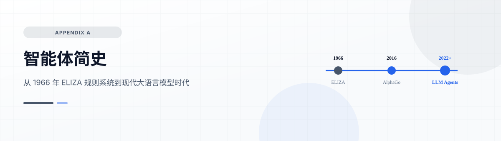

# 附录A：智能体简史 {.unnumbered}

{.chapter-hero width="100%"}
本附录精简自原第2章，为感兴趣的读者提供历史背景。如果你更关注动手实践，可随时跳回第2章继续构建 Agent。

## 符号主义时代

**符号主义（Symbolicism）** 认为智能可以通过形式化符号体系刻画。标志性成果是**专家系统**：由 IF-THEN 规则组成的**知识库** + **推理机**（正向链/反向链）。代表作品包括 MYCIN（医疗诊断）。

### ELIZA 聊天机器人

ELIZA 由 MIT 的 Joseph Weizenbaum 于 1966 年推出，模拟罗杰斯学派心理治疗师。核心机制是**模式匹配与文本替换**：

1. 关键词识别与排序
2. 分解规则（通配符提取）
3. 重组规则（随机选择回复模板）
4. 代词转换（I→you, my→your）

```python
import re, random

RULES = {
    r"I need (.*)": [
        "Why do you need {0}?",
        "Would it really help you to get {0}?",
    ],
    r"I am (.*)": [
        "How long have you been {0}?",
        "Did you come to me because you are {0}?",
    ],
    r".*": [
        "Please tell me more.",
        "Can you elaborate on that?",
    ],
}

PRONOUN_SWAP = {"i": "you", "you": "i", "me": "you", "my": "your"}

def respond(user_input: str) -> str:
    for pattern, templates in RULES.items():
        m = re.match(pattern, user_input, re.IGNORECASE)
        if m:
            captured = m.group(1) if m.lastindex else ""
            swapped = " ".join(
                PRONOUN_SWAP.get(w, w)
                for w in captured.lower().split()
            )
            return random.choice(templates).replace("{0}", swapped)
    return "I'm not sure I understand."

# 完整代码: code/chapter02_eliza/eliza.py
```

::: {.callout-tip}
## ELIZA 效应

许多用户对 ELIZA 产生了情感依赖，相信它真的理解自己——尽管它只是做模式匹配。这种现象被称为 **ELIZA 效应**，至今仍在现代对话式 AI 中反复出现。
:::

::: {.content-visible when-format="html"}
```{=html}
<div class="agent-toy" data-toy="appa-eliza-bot"></div>
```
:::

### ELIZA 的局限

| 局限 | 对现代 Agent 的启示 |
|------|-------------------|
| 缺乏语义理解 | Agent 需要真正的推理能力 |
| 缺少上下文记忆 | Agent 需要记忆系统（第9章） |
| 规则扩展困难 | Agent 需要学习和泛化能力 |

## 联结主义与强化学习

**联结主义**的核心：知识不再以显式规则存储，而是以**连接权重**形式分布于人工神经元之间，通过学习调整权重。

**强化学习（RL）**：Agent 通过与环境交互、试错来最大化长期回报。AlphaGo 通过数百万次自我对弈不断优化策略。

## 大语言模型时代

在海量文本上预训练的 LLM 形成了一个高度压缩的世界知识隐式模型。当模型规模跨越临界点后，涌现出：

- **上下文学习**：无需更新权重，通过输入中的示例完成新任务
- **思维链推理**：引导模型逐步推理，显著提升复杂问题表现

## 小结

- **符号主义**（1950s-1980s）：规则和逻辑，ELIZA、专家系统
- **联结主义与 RL**（1980s-2010s）：从数据中学习，AlphaGo
- **LLM 时代**（2020s-至今）：预训练 + 涌现能力，现代 Agent 基石

配套 ELIZA 代码：`code/chapter02_eliza/eliza.py`
