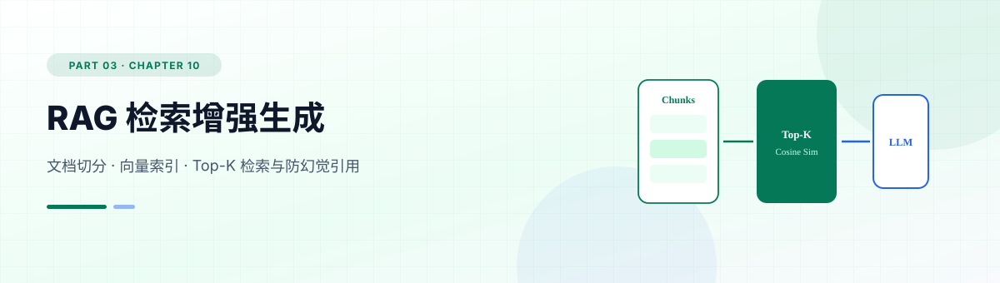

# RAG 检索增强生成

{.chapter-hero width="100%"}
::: {.callout-note}
## 上一章回顾

第 9 章我们为 Agent 构建了多层记忆系统——工作记忆、情景记忆、语义记忆。但这三种记忆都依赖 Agent **自己从对话中积累**。如果用户问了一个 Agent 从未接触过的领域问题怎么办？本章引入 **RAG（检索增强生成）**——让 Agent 能从外部文档库中检索知识。
:::

## 为什么需要 RAG

### LLM 的两个硬伤

1. **知识截止**：模型训练完成后，不再知道新发生的事情
2. **幻觉问题**：模型可能生成听起来合理但实际错误的内容

RAG 的解决思路很朴素：**在让 LLM 回答之前，先从知识库中检索相关资料，一并塞给它**。

```
用户 → 检索相关文档 → 文档+问题 → LLM → 带来源的回答
```

::: {.callout-tip}
## 配套代码

```bash
python chapter10_rag/doc_loader.py         # 文档加载
python chapter10_rag/text_splitter.py      # 文本分块
python chapter10_rag/vector_store.py       # 向量存储
python chapter10_rag/retriever.py          # 检索器
python chapter10_rag/rag_prompt.py         # Prompt 模板
python chapter10_rag/rag_agent.py          # 完整项目
```
:::

## RAG 的核心流程

```
文档加载 → 文本分块 → 向量化存储 → 检索 → Prompt 增强 → LLM 生成
```

### 1. 文档加载

```python
@dataclass
class Document:
    content: str
    doc_id: str
    metadata: dict

def load_text(filepath: str) -> Document:
    with open(filepath) as f:
        return Document(content=f.read(), doc_id=filepath)
```

### 2. 文本分块

长文档不能整个塞进上下文。需要**切分为小块（chunks）**，且小块之间有重叠以避免关键信息被割裂：

```python
class TextSplitter:
    def __init__(self, chunk_size=500, chunk_overlap=50):
        self.chunk_size = chunk_size
        self.chunk_overlap = chunk_overlap

    def split(self, text: str) -> list[str]:
        chunks = []
        start = 0
        while start < len(text):
            end = start + self.chunk_size
            chunks.append(text[start:end])
            start += self.chunk_size - self.chunk_overlap
        return chunks

    def split_by_paragraph(self, text: str) -> list[str]:
        return [p.strip() for p in text.split('\n\n') if p.strip()]
```

::: {.content-visible when-format="html"}
```{=html}
<div class="agent-toy" data-toy="ch10-chunking-lab"></div>
```
:::

### 3. 向量化存储与检索

基于 TF-IDF 的轻量向量存储（无需外部数据库）：

```python
class SimpleVectorStore:
    def __init__(self):
        self.documents: list[Document] = []

    def add_documents(self, docs: list[Document]):
        self.documents.extend(docs)

    def search(self, query: str, top_k=5) -> list[tuple[Document, float]]:
        """余弦相似度检索"""
        q_vec = self._tfidf_vector(query)
        scores = []
        for doc in self.documents:
            d_vec = self._tfidf_vector(doc.content)
            sim = self._cosine_similarity(q_vec, d_vec)
            scores.append((doc, sim))
        scores.sort(key=lambda x: x[1], reverse=True)
        return scores[:top_k]
```

### 4. 检索器

```python
class Retriever:
    def retrieve(self, query: str, top_k=5):
        return self.store.search(query, top_k=top_k)

    def multi_query_retrieve(self, query: str, top_k=5):
        """多查询扩展：LLM 改写 query 多次，合并结果提升召回率"""
        ...

    def format_context(self, results) -> str:
        """将检索结果格式化为带来源编号的上下文"""
        ...
```

::: {.content-visible when-format="html"}
```{=html}
<div class="agent-toy" data-toy="ch10-tfidf-retriever"></div>
```
:::

### 5. RAG Prompt 模板

```python
RAG_PROMPT = """根据以下资料回答用户问题。

要求：
- 仅使用提供的资料
- 如果资料不足，明确说明
- 引用来源编号

资料：
{context}

用户问题：{question}
回答："""
```

## 项目：完整 RAG Agent

```python
class RAGAgent:
    def __init__(self, llm):
        self.splitter = TextSplitter(chunk_size=500, chunk_overlap=50)
        self.vector_store = SimpleVectorStore()
        self.retriever = Retriever(self.vector_store)

    def add_documents(self, filepaths: list[str]):
        """加载文档并建立索引"""
        for path in filepaths:
            doc = load_text(path)
            chunks = self.splitter.split(doc.content)
            self.vector_store.add_documents([
                Document(c, f"{path}#{i}", {"source": path})
                for i, c in enumerate(chunks)
            ])

    def run(self, user_input: str) -> str:
        results = self.retriever.retrieve(user_input, top_k=3)
        context = self.retriever.format_context(results)
        prompt = RAG_PROMPT.format(context=context, question=user_input)
        return self.llm.chat([
            {"role": "system", "content": "你是一个基于资料回答的助手。"},
            {"role": "user", "content": prompt},
        ])
```

完整代码见 `code/chapter10_rag/rag_agent.py`。

## 本章小结

RAG 的核心流程：**加载 → 分块 → 向量化 → 检索 → 增强 → 生成**

| 组件 | 核心功能 |
|------|---------|
| 文档加载 | txt / markdown 读取 |
| 文本分块 | 固定大小 + 段落分割 + 重叠 |
| 向量存储 | TF-IDF + 余弦相似度 |
| 检索器 | top-k + 多查询扩展 |
| Prompt | 来源引用 + 防幻觉约束 |

::: {.callout-note}
## 下一章预告

有了记忆和 RAG，Agent 能访问的信息量大幅增加。但上下文窗口有限——如何决定哪些信息进入当前上下文？下一章介绍**上下文工程**：上下文的选择、压缩和优化。
:::

## 练习

1. 修改 `chunk_size` 和 `chunk_overlap`，观察检索结果的变化。
2. 用多查询扩展提升检索召回率。
3. 将 RAG Agent 和第 9 章的记忆系统整合。
