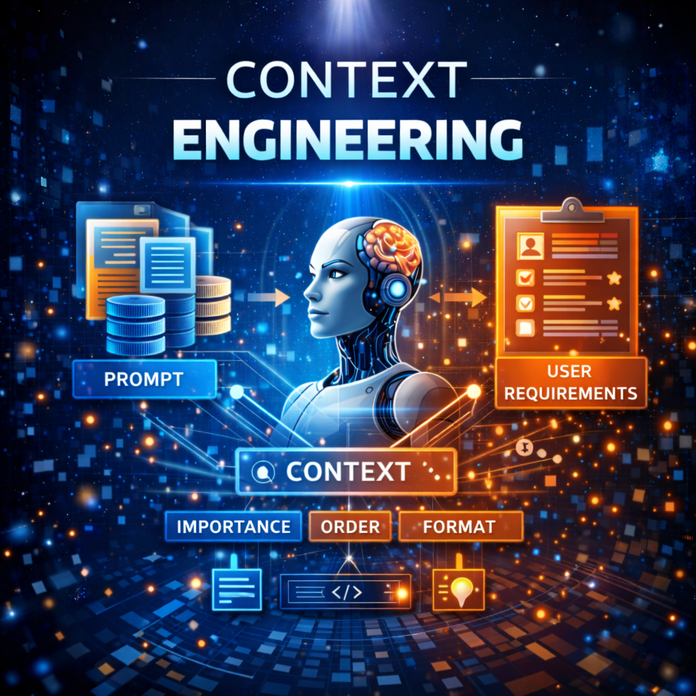

# 上下文工程

{width="350"}

::: {.callout-note}
## 上一章回顾

第 9 章我们构建了记忆系统，第 10 章加入了 RAG 检索。现在 Agent 拥有多源信息：对话历史、工作记忆、情景记忆、语义记忆、RAG 检索结果。但上下文窗口只有 128K tokens——如何决定哪些信息进入当前上下文？这是**上下文工程**要解决的问题。
:::

## 从 Prompt Engineering 到 Context Engineering

提示工程（Prompt Engineering）关注的是**怎么写好一条 Prompt**。但当你面对的是一个拥有记忆、工具、RAG 的复杂 Agent 时，问题变成了：

**什么样的上下文配置，最有可能让模型产出我们期望的行为？**

上下文配置包括：System Prompt、对话历史、记忆检索结果、RAG 检索结果、工具调用结果、指令。

::: {.callout-tip}
## 配套代码

```bash
python chapter11_context/context_assembler.py   # 上下文组装
python chapter11_context/context_compressor.py  # 上下文压缩
python chapter11_context/token_budget.py        # Token 预算
python chapter11_context/context_cache.py       # 上下文缓存
python chapter11_context/context_agent.py       # 完整项目
```
:::

## 上下文的组成

```python
class ContextRole(str, Enum):
    SYSTEM = "system"          # 系统提示
    HISTORY = "history"        # 对话历史
    MEMORY = "memory"          # 记忆检索结果
    KNOWLEDGE = "knowledge"    # RAG 检索结果
    INSTRUCTION = "instruction"  # 动态指令
```

## 上下文组装策略

### 优先级策略

每种上下文有不同优先级，按优先级分配 Token 预算：

```
System Prompt (1.0) > Instruction (0.9) > Knowledge (0.8) > Memory (0.7) > History (0.6)
```

```python
class ContextAssembler:
    def __init__(self, max_tokens=8000):
        self.max_tokens = max_tokens
        self.contexts: dict[ContextRole, list[ContextItem]] = {}

    def assemble(self, query: str) -> list[ContextItem]:
        """按优先级组装，直到预算用完"""
        selected = []
        budget = self.max_tokens

        # 按优先级排序
        priorities = sorted(self.contexts.items(),
                          key=lambda x: x[0].priority, reverse=True)

        for role, items in priorities:
            for item in sorted(items, key=lambda x: x.importance, reverse=True):
                cost = count_tokens(item.content)
                if budget >= cost:
                    selected.append(item)
                    budget -= cost

        return selected
```

### 分层策略

```
Layer 1 (核心，始终包含): System Prompt + 当前轮用户消息
Layer 2 (重要，空间允许时包含): 最近对话 + 相关知识
Layer 3 (补充，空间充足时包含): 旧记忆 + 旧对话
```

## 上下文压缩

当 Token 超限时，需要压缩：

```python
class ContextCompressor:
    def compress(self, items, target_length, strategy="importance"):
        if strategy == "importance":
            # 保留最重要的
            items.sort(key=lambda x: x.importance, reverse=True)
            result = []
            budget = target_length
            for item in items:
                cost = count_tokens(item.content)
                if budget >= cost:
                    result.append(item)
                    budget -= cost
            return result

        elif strategy == "recent":
            # 保留最近的
            items.sort(key=lambda x: x.timestamp, reverse=True)
            ...

        elif strategy == "summarize":
            # 用 LLM 摘要长上下文
            ...
```

### Token 预算管理

```python
class TokenBudget:
    def __init__(self, total=8000):
        self.total = total
        self.allocations = {
            "system": 0.15,
            "history": 0.30,
            "memory": 0.15,
            "knowledge": 0.30,
            "instruction": 0.10,
        }

    def allocate(self) -> dict:
        return {k: int(v * self.total) for k, v in self.allocations.items()}
```

::: {.content-visible when-format="html"}
```{=html}
<div class="agent-toy" data-toy="ch11-token-budget"></div>
```
:::

## 上下文缓存

对高频查询，缓存组装好的上下文：

```python
class ContextCache:
    def __init__(self, max_size=100):
        self.cache = {}
        self.max_size = max_size

    def get(self, query_prefix: str):
        return self.cache.get(query_prefix)

    def set(self, query_prefix: str, context):
        if len(self.cache) >= self.max_size:
            # LRU 驱逐
            oldest = min(self.cache.keys(),
                        key=lambda k: self.cache[k].timestamp)
            del self.cache[oldest]
        self.cache[query_prefix] = context
```

::: {.content-visible when-format="html"}
```{=html}
<div class="agent-toy" data-toy="ch11-kv-cache"></div>
```
:::

## 项目：上下文感知 Agent

```python
class ContextAwareAgent:
    def __init__(self, llm, memory_manager, rag_system=None):
        self.assembler = ContextAssembler(max_tokens=8000)
        self.compressor = ContextCompressor()
        self.cache = ContextCache()
        self.memory = memory_manager
        self.rag = rag_system

    def run(self, user_input: str) -> str:
        # 1. 收集候选上下文
        candidates = []
        candidates.extend(self._get_memory_context(user_input))
        if self.rag:
            candidates.extend(self._get_rag_context(user_input))

        # 2. 组装/压缩上下文
        if count_tokens(candidates) > self.assembler.max_tokens:
            candidates = self.compressor.compress(
                candidates, self.assembler.max_tokens)

        # 3. 构建最终 messages
        messages = self.assembler.assemble(user_input, candidates)
        return self.llm.invoke(messages)
```

## 常见陷阱与对策

| 陷阱 | 后果 | 对策 |
|------|------|------|
| 上下文过载 | 模型被信息淹没 | 设置合理 Token 上限 |
| 上下文冲突 | System Prompt 与检索知识矛盾 | 明确优先级 |
| 上下文陈旧 | 用过时信息回答 | 时间排序 + 定期清理 |
| 上下文单调 | 只有一种信息来源 | 使用多样性优化 |

## 本章小结

上下文工程关注**在有限的 Token 预算中放入最有价值的信息**：

| 能力 | 实现 |
|------|------|
| 组装 | 优先级策略 / 分层策略 |
| 压缩 | 重要性过滤 / 时间筛选 / LLM 摘要 |
| 预算 | 按角色分配 Token 配额 |
| 缓存 | LRU 缓存常用上下文 |

::: {.callout-note}
## 下一章预告

我们现在有了一个能力完整的单 Agent。但现实世界的复杂问题往往需要**多个 Agent 分工协作**。第 12 章将进入多智能体系统的世界——用 AutoGen 构建双 Agent 协作系统。
:::

## 练习

1. 修改优先级权重，观察不同配置下 Agent 的回答质量。
2. 实现上下文 A/B 测试：对同一组问题用两种不同的组装策略，对比效果。
3. 为 ContextCompressor 添加 LLM 摘要压缩，对比截断 vs 摘要的效果。
