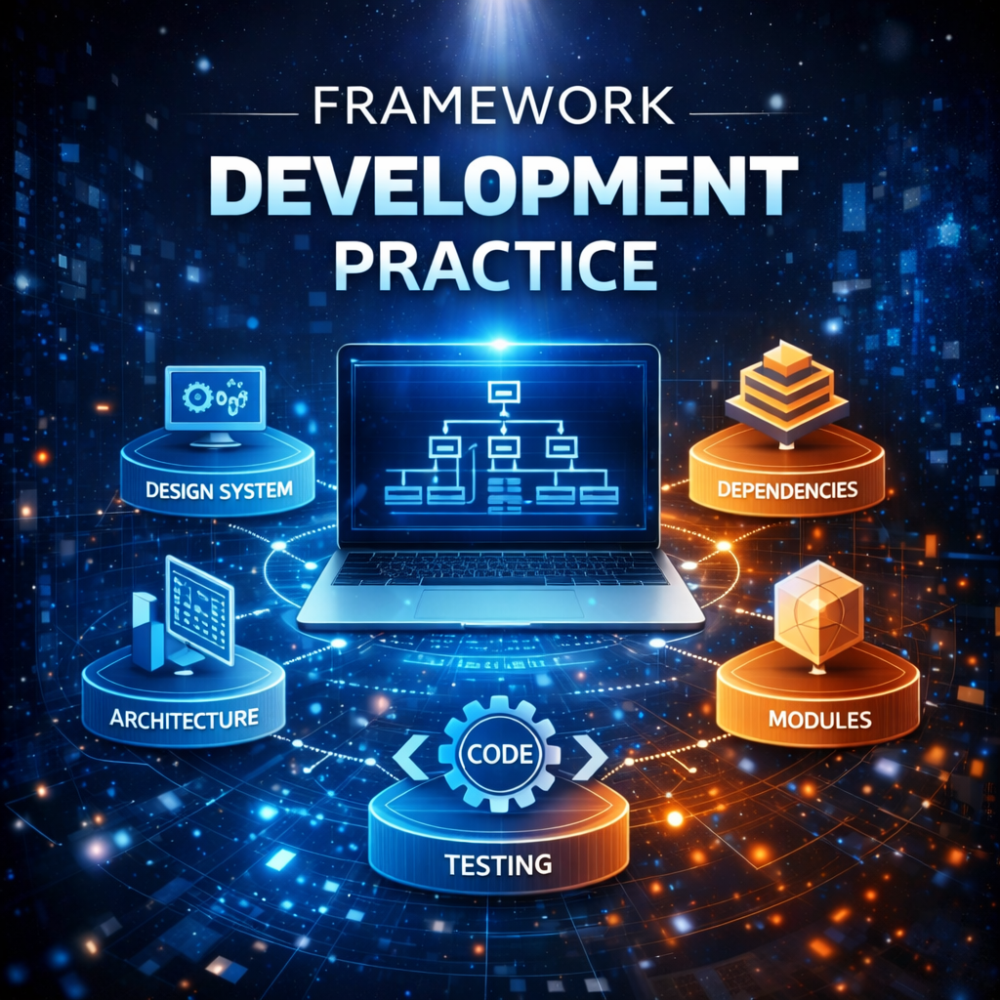

# 多智能体协作

{width="350"}

::: {.callout-note}
## 上一章回顾

第 11 章我们掌握了上下文工程——通过动态上下文组装、压缩和检索，让 Agent 高效管理长对话中的信息。到目前为止，我们构建的都是**单智能体系统**——一个 Agent 独立完成任务。但现实中的复杂问题往往需要多个专业角色分工协作。本章将进入**多智能体系统**的世界。
:::

## 单智能体的局限

单智能体系统面临三个根本瓶颈：

1. **能力天花板**：一个 LLM 调用无论多强，推理深度和广度都有上限
2. **角色过载**：单个 Agent 同时承担规划、执行、检查、总结，Prompt 越来越臃肿
3. **缺乏制衡**：没有独立的检查机制，错误只能在最终输出时发现

多智能体系统的核心思想很朴素：**让多个各司其职的 Agent 协作，模拟人类团队的工作方式**。

## 多智能体的核心概念

### 角色分工

每个 Agent 有明确的角色定义，角色决定了它的 System Prompt、可用工具和行为边界：

| 角色 | 职责 | 典型 Prompt 关键词 |
|------|------|-------------------|
| Planner | 拆解任务，生成计划 | "拆解"、"列出步骤" |
| Executor | 执行具体步骤 | "执行"、"调用工具" |
| Critic | 审查输出，发现问题 | "检查"、"找出漏洞" |
| Synthesizer | 汇总各方输出 | "综合"、"给出最终回答" |

### 通信模式

多智能体之间的通信主要有三种模式：

- **顺序流水线（Pipeline）**：A → B → C，每个 Agent 处理上游输出
- **轮询对话（Round-Robin）**：多个 Agent 轮流发言，共享上下文
- **中心调度（Orchestrator）**：一个 Manager Agent 决定谁在什么时候发言

### 终止条件

多智能体系统如果没有明确的终止条件，会天然走向失控。常见策略：

- **关键词触发**：某 Agent 输出特定词语（如 `APPROVE`）时终止
- **最大轮数**：达到预设对话轮数后强制终止
- **语义判断**：由协调者或评估器判断任务是否达成

::: {.content-visible when-format="html"}
```{=html}
<div class="agent-toy" data-toy="ch12-topology-sim"></div>
```
:::

## 实战：用 AutoGen 构建多 Agent 团队

AutoGen 是微软开源的多智能体框架。以下示例展示了一个典型的多 Agent 协作场景：**产品负责人 + 评审者** 共同完成优先级 Backlog。

### 场景

为流程自动化候选项制作 RICE 优先级 Backlog，包含实施计划和风险清单。

```python
import asyncio
from autogen_agentchat.agents import AssistantAgent
from autogen_agentchat.conditions import TextMentionTermination
from autogen_agentchat.teams import RoundRobinGroupChat
from autogen_agentchat.ui import Console
from autogen_ext.models.openai import OpenAIChatCompletionClient


# ============================================================
# 1. 工具函数：RICE 评分
# ============================================================
def rice_score(reach: int, impact: float, confidence: float, effort: float) -> float:
    """RICE = (Reach × Impact × Confidence) / Effort"""
    if effort <= 0:
        raise ValueError("effort must be > 0")
    if not (0 <= confidence <= 1):
        raise ValueError("confidence must be between 0 and 1")
    return (reach * impact * confidence) / effort


async def main():
    # ============================================================
    # 2. 模型客户端（连接本地 Ollama）
    # ============================================================
    model_client = OpenAIChatCompletionClient(
        model="qwen3:14b",
        base_url="http://localhost:11434/v1",
        api_key="ollama",
        temperature=0.3,
        model_info={
            "family": "llama",
            "vision": False,
            "function_calling": True,
            "json_output": True,
            "structured_output": False,
        },
    )

    # ============================================================
    # 3. 主执行 Agent（产品负责人）
    # ============================================================
    primary = AssistantAgent(
        name="primary",
        model_client=model_client,
        tools=[rice_score],
        system_message=(
            "你是流程自动化产品负责人。\n"
            "任务：把候选流程自动化需求整理为可交付的优先级 Backlog。\n"
            "硬性约束：每一个候选项都必须调用 rice_score 计算 RICE。\n"
            "输出：Markdown 表格（含 RICE 排序）+ 实施计划 + 风险清单。\n"
            "结尾输出关键字：READY_FOR_REVIEW"
        ),
    )

    # ============================================================
    # 4. 评审 Agent（收敛机制）
    # ============================================================
    critic = AssistantAgent(
        name="critic",
        model_client=model_client,
        system_message=(
            "你是严格的 Reviewer。\n"
            "检查：RICE 是否已计算、表格字段完整、实施计划可执行、\n"
            "风险与指标具体可量化。\n"
            "不满足：给出明确修改清单。全部满足：只回复 APPROVE。"
        ),
    )

    # ============================================================
    # 5. 终止条件 & 团队
    # ============================================================
    termination = TextMentionTermination("APPROVE")
    team = RoundRobinGroupChat(
        participants=[primary, critic],
        termination_condition=termination,
    )

    # ============================================================
    # 6. 任务
    # ============================================================
    task = """
请为以下流程自动化候选项制作优先级 Backlog（使用 RICE）：

候选项 A：客服工单分类与自动分派
- Reach=12000, Impact=1.2, Confidence=0.65, Effort=1.8

候选项 B：财务对账异常自动识别
- Reach=1800, Impact=2.2, Confidence=0.55, Effort=2.5

候选项 C：HR 入职材料自动校验
- Reach=600, Impact=0.9, Confidence=0.8, Effort=0.9
"""

    # ============================================================
    # 7. 运行
    # ============================================================
    await Console(team.run_stream(task=task))
    await model_client.close()


if __name__ == "__main__":
    asyncio.run(main())
```

### 系统运行剖析

这段代码构建的是一个**可运行的多智能体协作系统**，而非简单的一问一答：

```
用户任务
   ↓
┌──────────────────────────────┐
│ primary (产品负责人)           │
│ 1. 解析任务                   │
│ 2. 调用 rice_score × 3        │
│ 3. 输出 Backlog 表格          │
│ 4. 信号: READY_FOR_REVIEW     │
└──────────┬───────────────────┘
           │
           ▼
┌──────────────────────────────┐
│ critic (评审者)                │
│ 1. 检查 RICE 是否已计算       │
│ 2. 检查表格字段完整性         │
│ 3. 满足 → 回复 APPROVE        │
│    不满足 → 给出修改清单       │
└──────────┬───────────────────┘
           │
           ▼
     APPROVE → 系统终止
```

关键设计要点：

| 设计要素 | 实现方式 | 为什么重要 |
|---------|---------|-----------|
| 角色分离 | primary vs critic 有独立的 system_message | 每个 Agent 职责单一，不互相干扰 |
| 工具赋予 | 只给 primary `rice_score`，critic 没有工具 | 谁执行、谁检查，权限清晰 |
| 收敛机制 | `TextMentionTermination("APPROVE")` | 语言即控制信号，主动终止 |
| 通信模式 | `RoundRobinGroupChat` 轮询 | 行为可预测，适合教学 |

## 智能体通信协议

当多智能体系统规模扩大，我们需要标准化的通信协议。HelloAgents 支持三层协议：

### MCP（Model Context Protocol）：Agent ↔ 工具

MCP 定义智能体与工具之间的标准化通信格式，类似于第 6 章 ToolExecutor 的协议化版本：

```
Agent → MCP Request: {"tool": "get_weather", "args": {"city": "北京"}}
Tool → MCP Response: {"result": "北京 当前天气：晴，气温 25°C"}
```

### A2A（Agent-to-Agent Protocol）：Agent ↔ Agent

A2A 定义智能体之间的点对点通信：

```python
# A2A 消息示例
a2a_message = {
    "from": "Researcher",
    "to": "Analyst",
    "type": "task_delegation",
    "content": "请分析以下研究资料...",
    "metadata": {"priority": "high", "deadline": "2026-05-23"},
}
```

### 选择协议的原则

| 场景 | 推荐协议 |
|------|---------|
| 单 Agent 调用工具 | MCP |
| 2–5 个 Agent 协作 | A2A（点对点） |
| 大规模 Agent 网络 | ANP（Agent Network Protocol） |

::: {.content-visible when-format="html"}
```{=html}
<div class="agent-toy" data-toy="ch12-handoff-inspector"></div>
```
:::

::: {.callout-tip}
## 多智能体设计原则

1. **角色设计 > 模型能力**：清晰的角色定义比更换更强模型带来的提升更稳定
2. **反对意见应是制度化的**：系统中必须有独立的 Critic 角色，不能依赖 Actor 自我检查
3. **没有终止条件的系统一定会失控**：始终定义明确的终止规则
4. **从简单开始**：两个 Agent 的 Pipeline 能解决的问题，不要引入 5 个 Agent 的 GroupChat
:::

## 本章小结

本章我们进入了多智能体协作的世界：

- 理解了单智能体的三个局限：能力天花板、角色过载、缺乏制衡
- 掌握了多智能体系统的核心概念：角色分工、通信模式、终止条件
- 通过 AutoGen 实战，构建了一个 **产品负责人 + 评审者** 的双 Agent 协作系统
- 了解了 MCP、A2A、ANP 三种通信协议的定位和适用场景

::: {.callout-note}
## 下一章预告

至此，我们已经覆盖了 Agent 开发的完整生命周期。第 13 章将关注一个被许多人忽视但至关重要的主题：**如何评估和持续改进 Agent 的性能**。我们将学习评估指标、Benchmark 设计，以及强化学习在 Agent 训练中的应用。
:::

## 练习

1. 在 AutoGen 示例中增加第三个 Agent（Synthesizer），负责在 primary 和 critic 达成一致后，输出最终的格式化报告。
2. 用第 8 章的 HelloAgents 框架，实现一个简单的双 Agent Pipeline：Researcher → Writer，Researcher 查询资料，Writer 撰写摘要。
3. 思考：在什么情况下，增加更多 Agent 反而会降低系统性能？至少列出三个场景。
