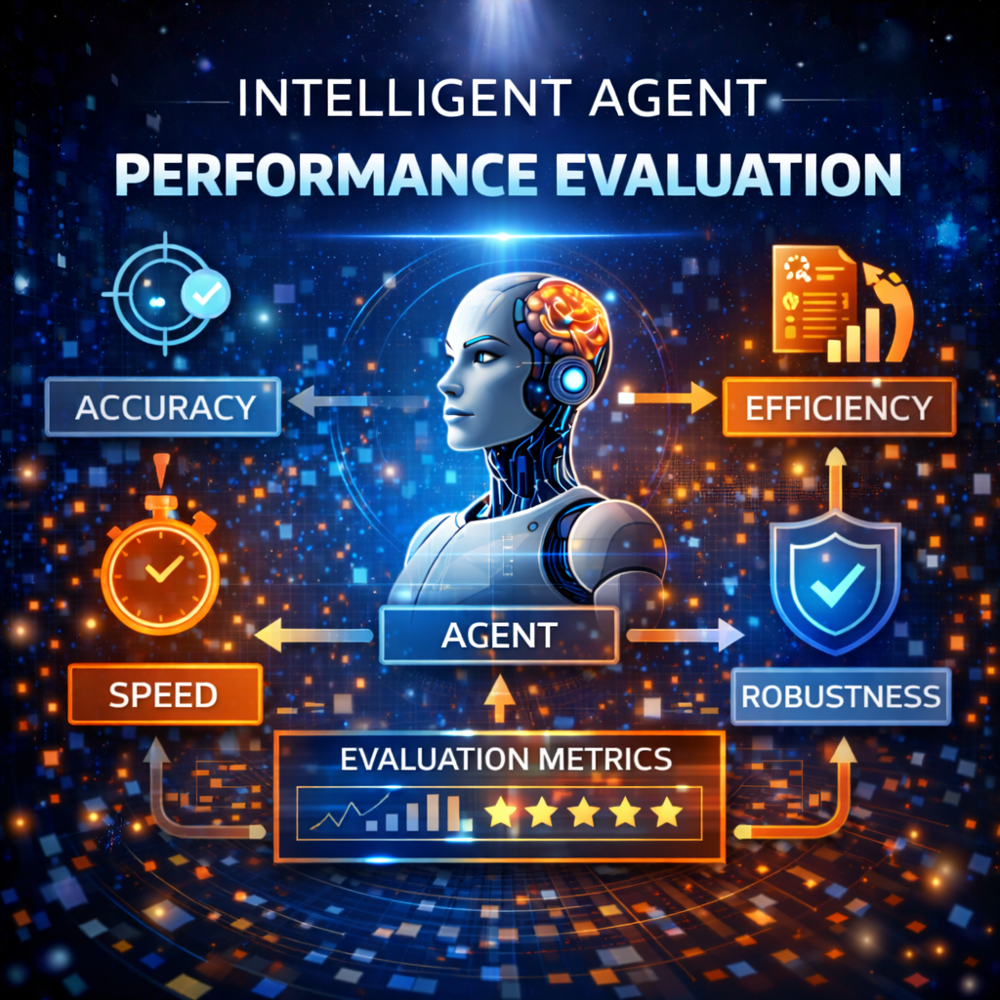

# 评估与持续改进

{width="350"}

::: {.callout-note}
## 上一章回顾

第 12 章我们构建了多智能体协作系统。现在你的工具箱里已经有了从单 Agent 工具调用到多 Agent 协作的完整能力。但还有一个关键问题没有解决：**如何客观地评估你的 Agent 做得好不好？如何系统性地改进它？** 这是工程落地的最后一公里。
:::

## 评估基础

### 为什么要评估

在 Agent 开发中，评估不是可选项——它是验证能力、发现问题、做出数据驱动决策的基石：

- **验证能力**：Agent 是否真的具备预期的功能？
- **发现问题**：Agent 在哪些任务上表现薄弱？
- **对比决策**：两个不同配置的 Agent，哪个更好？
- **防止回退**：修改代码后，性能是否下降了？

### 评估的核心要素

| 要素 | 说明 | 示例 |
|------|------|------|
| **评估指标** | 衡量性能的标准 | 准确率、响应时间、Token 消耗 |
| **评估任务** | Agent 需要完成的具体任务 | "翻译下面的英文" |
| **评估数据集** | 一组相关的评估任务 | 50 条中英翻译对 |
| **评估器** | 执行评估过程的组件 | 自动对比输出与期望 |

## 评估指标

### 准确率指标

```python
def compute_accuracy(output: str, expected: str, match_type: str = "contains") -> float:
    """计算输出与期望的匹配度"""
    if match_type == "exact":
        return 1.0 if output.strip() == expected.strip() else 0.0
    elif match_type == "contains":
        return 1.0 if expected in output else 0.0
    else:
        raise ValueError(f"Unknown match_type: {match_type}")

print(compute_accuracy("The capital of France is Paris.", "Paris", "contains"))  # 1.0
```

### 响应时间与 Token 消耗

```python
import time

def evaluate_with_metrics(agent, task: str, expected: str) -> dict:
    start = time.time()
    output = agent.run(task)
    elapsed = time.time() - start
    return {
        "accuracy": compute_accuracy(output, expected),
        "response_time": round(elapsed, 2),
        "output_length": len(output),
    }
```

### 设计评估数据集

好的评估数据集应覆盖多种场景：

```python
BENCHMARK = [
    {"task": "What is 2 + 2?", "expected": "4", "category": "math"},
    {"task": "翻译: Hello, how are you?", "expected": "你好", "category": "translation"},
    {"task": "解释什么是 API。", "expected": "", "category": "explanation"},
]

def run_benchmark(agent, benchmark: list[dict]) -> list[dict]:
    return [{
        "task": item["task"][:40],
        "category": item["category"],
        "accuracy": compute_accuracy(agent.run(item["task"]), item.get("expected", "")) if item.get("expected") else None,
    } for item in benchmark]
```

::: {.content-visible when-format="html"}
```{=html}
<div class="agent-toy" data-toy="ch13-eval-dashboard"></div>
```
:::

## LLM-as-Judge：用 LLM 评估 LLM

对于开放性问题，没有标准答案。此时可以用另一个 LLM 作为"裁判"：

```python
def llm_judge(question: str, answer: str, criteria: list[str]) -> dict:
    prompt = f"""请根据以下标准对回答进行评分（1-5分）。

标准：{', '.join(criteria)}
问题：{question}
回答：{answer}

返回 JSON：{{"scores": {{}}, "overall": 0, "reason": ""}}
"""
    response = client.chat.completions.create(
        model=MODEL,
        messages=[{"role": "system", "content": "你是一个评审员。"}, {"role": "user", "content": prompt}],
        temperature=0.0,
        response_format={"type": "json_object"},
    )
    return json.loads(response.choices[0].message.content)
```

::: {.callout-tip}
LLM-as-Judge 工程要点：裁判模型能力应不弱于被评估模型；必须提供具体分项 Rubric 与参考答案以抑制长度偏差与位置偏差；关键评测建议多裁判交叉验证。
:::

::: {.content-visible when-format="html"}
```{=html}
<div class="agent-toy" data-toy="ch13-llm-judge"></div>
```
:::

## 基于强化学习的 Agent 训练

### 核心概念

| 概念 | Agent 领域中的含义 |
|------|-------------------|
| **状态（State）** | 当前对话历史 + 工具调用结果 |
| **动作（Action）** | LLM 生成的下一步文本/工具调用 |
| **奖励（Reward）** | 对 Agent 行为好坏的量化反馈 |

### 奖励函数设计

```python
class AgentReward:
    def compute(self, task_completed: bool, steps_taken: int,
                user_satisfaction: float | None = None) -> float:
        reward = 1.0 if task_completed else -0.5
        reward -= steps_taken * 0.05  # 鼓励高效
        if user_satisfaction is not None:
            reward += user_satisfaction * 0.5
        return reward
```

### GRPO

**群组相对策略优化（GRPO）** 通过群体采样和相对比较来优化 Agent：
1. 对同一任务生成多个响应
2. 奖励函数打分
3. 高分/低分作为正/负样本
4. 对比学习更新模型

## 评估与改进的工程实践

```
代码修改 → 运行 Benchmark → 对比历史基线 → 决策
    ↑                                          │
    └────────── 如果性能下降，回退 ──────────────┘
```

**持续改进清单**：
1. 建立 Baseline
2. 小步迭代（每次只改一个变量）
3. 自动化评估（集成到 CI/CD）
4. 保留 Bad Cases 作为回归测试
5. 关注综合指标（不只看准确率）

## 本章小结

| 能力 | 核心方法 | 效果 |
|------|---------|------|
| **多维度指标** | 准确率、响应时间、Token 消耗 | 全面衡量 |
| **Benchmark** | 结构化测试数据集 | 可重复对比 |
| **LLM-as-Judge** | LLM 评估开放性问题 | 无标准答案场景 |
| **RL 训练** | 奖励函数 + GRPO | 自动优化 |
| **评估 Pipeline** | 自动化 + 基线对比 | 防止回退 |

::: {.callout-tip}
## 本书收官

至此，我们走完了从零开始学习 Agent 的完整旅程：

1. 认识智能体（第 1 章）
2. API 调用与第一个 Agent（第 2 章）
3. 完整对话 Agent（第 3 章）
4. 流式输出与健壮性（第 4 章）
5. 结构化输出（第 5 章）
6. 工具系统（第 6 章）
7. 推理范式（第 7 章）
8. 自建框架（第 8 章）
9. 记忆系统（第 9 章）
10. RAG 检索增强（第 10 章）
11. 上下文工程（第 11 章）
12. 多智能体协作（第 12 章）
13. 评估与改进（本章）

Agent 技术仍在快速演进。本书的目标是**掌握构建 Agent 系统所需的底层思维和工程能力**——无论框架如何变化，这些能力都是最稳固的基石。
:::

## 练习

1. 为第 6 章的旅行助手设计一个包含 10 个测试用例的 Benchmark。
2. 实现 LLM-as-Judge 评估器，评估 5 个开放性问题。
3. 用两个不同的 LLM 运行同一个 Benchmark，对比性能差异。
