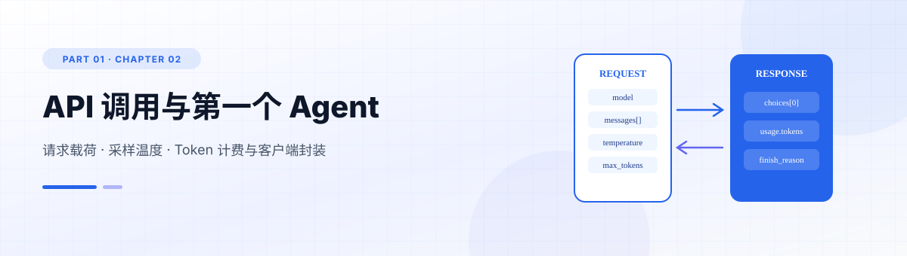

# API 调用与第一个 Agent

{.chapter-hero width="100%"}
::: {.callout-note}
## 上一章回顾

第 1 章我们认识了智能体的基本概念，并用 30 行 Python 构建了一个能对话的 SimpleAgent。但那 30 行代码里引用了 `OpenAI()` 客户端——它从哪里来？`messages` 参数的结构是什么？`temperature` 是什么意思？本章将回答这些问题，从零开始掌握大语言模型 API 的调用方式。
:::

## 环境准备

### 安装依赖

构建 Agent 只需要两个核心库：

```bash
pip install openai python-dotenv
```

- **openai**：OpenAI 官方 Python SDK，兼容所有 OpenAI 接口的服务（包括本地 Ollama、国产模型等）
- **python-dotenv**：从 `.env` 文件加载环境变量，避免在代码中硬编码 API 密钥

::: {.callout-tip}
## 配套代码

本章所有代码位于 `code/chapter02_api/`，按知识点拆分为独立文件：

```bash
cd code
cp .env.example .env        # 编辑 .env 填入你的 API Key
pip install -r requirements.txt

# 按顺序运行
python chapter02_api/first_api_call.py    # 第一个 API 调用
python chapter02_api/parse_response.py    # 理解响应结构
python chapter02_api/token_intro.py       # Token 概念
python chapter02_api/llm_client.py        # 封装可复用客户端
python chapter02_api/chat_loop.py         # 交互式对话循环
```
:::

### 获取 API Key

你需要一个 API Key 来调用大模型。以下是几个常用选项：

| 提供商 | 获取方式 | 说明 |
|--------|---------|------|
| **OpenAI** | [platform.openai.com](https://platform.openai.com) → API Keys | 需要海外手机号注册，需充值 |
| **硅基流动** | [siliconflow.cn](https://siliconflow.cn) → API 密钥 | 国内可访问，支持多种开源模型 |
| **DeepSeek** | [platform.deepseek.com](https://platform.deepseek.com) → API Keys | 国产模型，性价比高 |
| **Ollama（本地）** | 安装 Ollama 后 `ollama pull llama3.2` | 免费，但需要本地 GPU |

无论选择哪个提供商，你都会获得一个形如 `sk-xxxx...` 的密钥。**不要**将其写在代码里——我们使用 `.env` 文件管理。

创建 `.env` 文件：

```bash
# .env —— 不要提交到 Git！
OPENAI_API_KEY=sk-your-key-here

# 如果使用兼容 OpenAI 接口的其他服务
# LLM_BASE_URL=https://api.siliconflow.cn/v1
# LLM_MODEL_ID=Qwen/Qwen2.5-7B-Instruct
```

## 第一个 API 调用

让我们从一个最简单的调用开始——向大模型说"你好"。

```python
import os
from openai import OpenAI
from dotenv import load_dotenv

load_dotenv()

# 初始化客户端
client = OpenAI(
    api_key=os.getenv("OPENAI_API_KEY", "ollama"),
    base_url=os.getenv("LLM_BASE_URL", "http://localhost:11434/v1"),
)
MODEL = os.getenv("LLM_MODEL_ID", "qwen3:14b")

# 发送请求
response = client.chat.completions.create(
    model=MODEL,
    messages=[
        {"role": "system", "content": "你是一个友善的AI助手。"},
        {"role": "user", "content": "你好！请用一句话介绍你自己。"},
    ],
    temperature=0.7,
)

# 提取回复
reply = response.choices[0].message.content
print(f"模型回复: {reply}")
```

运行结果：

```
模型回复: 你好！我是你的AI助手，随时准备回答问题和提供帮助。
```

### 代码拆解

这个短短的程序包含了调用大模型 API 的全部核心要素：

| 要素 | 代码 | 说明 |
|------|------|------|
| **认证** | `api_key=os.getenv("OPENAI_API_KEY")` | 从环境变量加载密钥，不硬编码 |
| **端点** | `base_url=...` | API 服务器的地址，决定调用哪个服务 |
| **模型** | `model="gpt-4o-mini"` | 指定使用哪个模型 |
| **消息** | `messages=[...]` | 对话内容，包含角色和文本 |
| **温度** | `temperature=0.7` | 控制输出的随机性 |

## 深入理解 API 响应

`response` 对象包含比 `content` 多得多的信息。让我们解剖它：

```python
response = client.chat.completions.create(
    model=MODEL,
    messages=[{"role": "user", "content": "用一句话解释什么是API。"}],
    temperature=0.3,
)

# --- 核心字段 ---
print(f"id: {response.id}")           # 本次请求的唯一ID
print(f"model: {response.model}")     # 实际使用的模型

# --- choices：模型返回的候选回复 ---
choice = response.choices[0]
print(f"finish_reason: {choice.finish_reason}")  # 为何停止生成
print(f"message.content: {choice.message.content}")

# --- usage：Token 消耗（你的账单） ---
usage = response.usage
print(f"prompt_tokens（输入）:     {usage.prompt_tokens}")
print(f"completion_tokens（输出）:  {usage.completion_tokens}")
print(f"total_tokens（总计）:       {usage.total_tokens}")
```

输出示例：

```
id: chatcmpl-xxx
model: gpt-4o-mini-2024-07-18
finish_reason: stop
message.content: API是应用程序之间的通信接口。

prompt_tokens（输入）:     25
completion_tokens（输出）:  11
total_tokens（总计）:       36
```

### finish_reason 的含义

`finish_reason` 标识模型停止生成的确切原因，是生产代码分支判断的关键依据：

| `finish_reason` | 含义 | 处理策略 |
|---|---|---|
| `stop` | 正常完成（遇到自然终止或 stop token） | 直接返回内容 |
| `length` | 触达 `max_tokens` 上限，输出可能被截断 | 增大 `max_tokens` 或精简 Prompt |
| `content_filter` | 输出命中安全策略被拦截 | 调整输入或触发安全兜底 |
| `tool_calls` | 模型请求调用外部工具而非直接回复 | 解析并执行工具，再回填结果 |

::: {.content-visible when-format="html"}
```{=html}
<div class="agent-toy" data-toy="ch02-api-anatomy"></div>
```
:::

### Token 消耗与计费

大模型 API **按 token 计费**，你为每次 API 调用支付：

```
费用 = (输入 token × 输入单价) + (输出 token × 输出单价)
```

以 GPT-4o-mini 为例（价格可能变动）：

```
输入: $0.15 / 百万 token
输出: $0.60 / 百万 token
```

一次简单对话通常消耗几十到几百 token，费用在几分钱以内。但当你构建复杂的 Agent 时——长对话历史、工具调用结果回填——token 消耗会快速增长。**始终关注 `usage.total_tokens`**。

## 理解 Token

### 什么是 Token

计算机只能处理数字，所以文本必须先转换为数值序列。这个转换过程叫**分词（Tokenization）**，产生的每个单元就是一个 **Token**。

Token **不是**单词，也不是字符。它介于两者之间——常见词是一个 token，罕见词拆成多个 token：

```python
import tiktoken

encoder = tiktoken.get_encoding("cl100k_base")  # GPT-4 的编码器

text = "Hello, how are you?"
tokens = encoder.encode(text)
print(tokens)        # [9906, 11, 1268, 527, 499, 30]
print(len(tokens))   # 6

# 中文通常比英文消耗更多 token
text_cn = "你好，最近怎么样？"
print(len(encoder.encode(text_cn)))  # 约 10-12 个 token
```

::: {.callout-important}
**中英文 Token 效率差异**：英文平均约 1.3 Token/词，中文常见编码下约 1.5–2 Token/字（现代中文优化词表略低）。同等语义下，中文输入输出的 Token 消耗通常高于英文，评估预算时应以实测 `usage` 为准。
:::

::: {.content-visible when-format="html"}
```{=html}
<div class="agent-toy" data-toy="ch02-token-cost"></div>
```
:::

### 为什么 Token 数量直接影响工程表现

1. **上下文窗口上限**：超过模型最大窗口（如 128K）会直接触发 400 错误或截断。
2. **调用成本**：多轮对话每次都要重传历史，Token 消耗随轮次近似平方增长。
3. **响应延迟**：输入越长，首字延迟（Prefill 阶段）越明显。

在后续章节中，我们会反复用到 `tiktoken` 来估算和管理 token 消耗。

## 模型选择指南

截至 2026 年，以下是一些常用模型的对比：

| 模型 | 上下文窗口 | 特点 | 适用场景 |
|------|-----------|------|---------|
| **GPT-4o-mini** | 128K | 性价比最高，速度快 | 日常 Agent、原型开发 |
| **GPT-4o** | 128K | 推理能力最强，多模态 | 复杂推理、代码生成 |
| **Claude 3.5 Sonnet** | 200K | 长上下文、安全对齐好 | 长文档分析 |
| **DeepSeek-V3** | 128K | 国产、性价比极高 | 中文任务、成本敏感 |
| **Qwen2.5 系列** | 32K-128K | 中文能力强、开源可本地部署 | 中文场景、数据隐私 |

对于学习 Agent 开发，**GPT-4o-mini 是最推荐的起点**：便宜、稳定、支持 Function Calling。

## 封装可复用的 LLM 客户端

在构建 Agent 时，你会频繁调用 LLM。将调用逻辑封装为一个类，避免代码重复：

```python
class LLMClient:
    """统一的 LLM 调用客户端"""

    def __init__(self, model=None, api_key=None, base_url=None):
        self.model = model or os.getenv("LLM_MODEL_ID", "qwen3:14b")
        self.client = OpenAI(
            api_key=api_key or os.getenv("OPENAI_API_KEY", "ollama"),
            base_url=base_url or os.getenv("LLM_BASE_URL", "http://localhost:11434/v1"),
        )

    def chat(self, messages: list[dict], temperature: float = 0.7,
             max_tokens: int | None = None) -> str:
        """发送消息，返回文本回复"""
        response = self.client.chat.completions.create(
            model=self.model,
            messages=messages,
            temperature=temperature,
            **(dict(max_tokens=max_tokens) if max_tokens else {}),
        )
        return response.choices[0].message.content

    def chat_with_usage(self, messages: list[dict], **kwargs) -> tuple[str, dict]:
        """返回回复文本和 token 消耗"""
        response = self.client.chat.completions.create(
            model=self.model, messages=messages, **kwargs,
        )
        text = response.choices[0].message.content
        usage = {
            "prompt_tokens": response.usage.prompt_tokens,
            "completion_tokens": response.usage.completion_tokens,
            "total_tokens": response.usage.total_tokens,
        }
        return text, usage
```

这个 `LLMClient` 将在整本书中被反复使用。它提供了：

- 统一的初始化接口（从环境变量加载配置）
- 简洁的 `chat()` 方法（一行代码调用 LLM）
- 可选的 `chat_with_usage()`（同时获取回复和 token 消耗）

## 项目：交互式对话机器人

将 LLM 客户端集成到一个终端对话循环中，这是我们构建完整 Agent 的第一步：

```python
class SimpleChatBot:
    """最简对话机器人"""

    def __init__(self, name: str = "小助手"):
        self.name = name
        self.client = OpenAI(
            api_key=os.getenv("OPENAI_API_KEY", "ollama"),
            base_url=os.getenv("LLM_BASE_URL", "http://localhost:11434/v1"),
        )
        self.model = os.getenv("LLM_MODEL_ID", "qwen3:14b")
        self.system_prompt = f"你是{name}，一个友善的AI助手。回答控制在3句话以内。"

    def reply(self, user_input: str) -> str:
        response = self.client.chat.completions.create(
            model=self.model,
            messages=[
                {"role": "system", "content": self.system_prompt},
                {"role": "user", "content": user_input},
            ],
            temperature=0.7,
        )
        return response.choices[0].message.content

    def run(self):
        print(f"\n{'='*50}")
        print(f"  {self.name} 已上线！输入 'quit' 退出")
        print(f"{'='*50}\n")

        while True:
            user_input = input("你: ").strip()
            if user_input.lower() in ("quit", "exit", "退出"):
                print(f"{self.name}: 再见！")
                break
            if not user_input:
                continue
            print(f"{self.name}: {self.reply(user_input)}\n")


if __name__ == "__main__":
    SimpleChatBot(name="小助手").run()
```

运行效果：

```
==================================================
  小助手 已上线！输入 'quit' 退出
==================================================

你: 你好！
小助手: 你好！有什么我可以帮忙的吗？

你: 我叫小明
小助手: 很高兴认识你，小明！有什么想聊的？

你: 还记得我叫什么吗？
小助手: 抱歉，我无法记住之前的对话。每次对话对我来说都是新的开始。

你: quit
小助手: 再见！
```

注意最后一轮对话——机器人**不记得**你刚才说你叫小明。这是因为每次 `reply()` 调用都是独立的，没有携带历史消息。这是 ChatBot 和 Agent 的根本差距之一。下一章我们将解决这个问题。

## 本章小结

本章你掌握了调用大语言模型 API 的完整基础：

- **环境配置**：`openai` + `python-dotenv` + `.env` 管理密钥
- **API 调用**：`client.chat.completions.create()` 的完整参数
- **响应结构**：`choices[0].message.content`、`finish_reason`、`usage`
- **Token 概念**：使用 `tiktoken` 计算 token 数，理解中英文差异
- **费用意识**：输入/输出 token 分别计费，关注 `total_tokens`
- **封装实践**：`LLMClient` 类作为后续所有 Agent 的基础组件

::: {.callout-note}
## 下一章预告

目前我们的机器人每轮对话都是"失忆"的——它不记得你上一句说了什么。下一章将实现**多轮对话管理**：消息历史、System Prompt 设计、角色扮演和上下文窗口管理。这是从 ChatBot 走向 Agent 的关键一步。
:::

## 练习

1. 更换 `LLM_MODEL_ID` 环境变量为其他模型（如 `gpt-4o` 或本地 Ollama 模型），对比同一个问题的回答差异。
2. 在 `SimpleChatBot` 中添加 token 消耗统计：每次对话后显示本次消耗的 token 数和累计消耗。
3. 修改 `temperature` 参数为 0、1.0、1.5，分别让模型讲同一个笑话，观察输出的差异。
