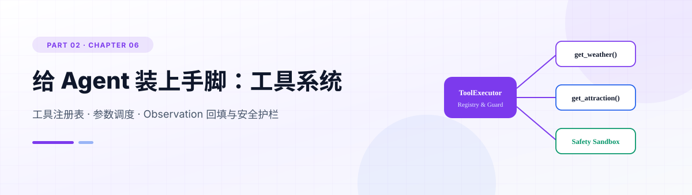

# 给 Agent 装上手脚：工具系统

{.chapter-hero width="100%"}
::: {.callout-note}
## 上一章回顾

第 5 章我们掌握了结构化输出和 OpenAI 原生 Function Calling。现在 Agent 能以结构化格式"说话"了。但它仍然局限于模型参数中的静态知识——它无法查询实时天气、无法搜索最新信息、无法执行代码。**工具系统**就是为解决这个局限而生。
:::

## Agent 与 ChatBot 的分水岭

回顾第 1 章的最简对话 Agent：

```python
agent.run("北京今天天气怎么样？")
# → "抱歉，我无法获取实时天气信息。"
```

模型的知识截止于训练数据。无论你的 Prompt 写得多好，它都无法回答需要**实时信息**或**外部操作**的问题。这是 ChatBot 的天花板。

而一个**拥有工具的 Agent** 则不同：

```python
agent.run("北京今天天气怎么样？")
# → Agent 内部调用 get_weather("北京") → 获取实时数据 → "北京当前晴，气温 25°C。"
```

Agent 不仅"说"，还能"做"。这就是本章的核心主题：**工具调用（Tool Calling）**。

::: {.callout-tip}
## 核心概念

**工具（Tool）** 是 Agent 与外部世界交互的接口。工具可以是：
- API 调用（天气、新闻、股价）
- 数据库查询
- 代码执行（计算、数据处理）
- 文件操作

Agent 通过**调用工具 → 获取结果 → 继续推理**的循环，突破了 LLM 静态知识的局限。
:::

## 工具的定义与实现

::: {.callout-tip}
## 配套代码

本章代码分为三个文件，位于 `code/chapter04_tool_system/`：
- `tools.py` — 天气查询 + 景点推荐工具
- `tool_executor.py` — 工具注册与执行器
- `travel_agent.py` — 完整的旅行助手 Agent

```bash
python code/chapter04_tool_system/travel_agent.py
```
:::

一个良好定义的工具应包含三个核心要素：

| 要素 | 说明 | 示例 |
|------|------|------|
| **名称（Name）** | 唯一标识符，供 LLM 在 Action 中调用 | `get_weather` |
| **描述（Description）** | 自然语言说明，告诉 LLM 这个工具何时使用 | "查询指定城市的实时天气" |
| **执行逻辑（Function）** | 实际执行任务的函数 | `def get_weather(city): ...` |

### 实现天气查询工具

使用免费的 `wttr.in` 服务，它能以 JSON 格式返回指定城市的天气数据：

```python
import requests
from urllib.parse import quote


def get_weather(city: str) -> str:
    """查询指定城市的实时天气"""
    try:
        url = f"https://wttr.in/{quote(city)}?format=j1&lang=zh"
        resp = requests.get(
            url,
            headers={"User-Agent": "weather-agent/0.1"},
            timeout=8,
        )
        resp.raise_for_status()
        data = resp.json()

        current = data["current_condition"][0]
        desc = current["weatherDesc"][0]["value"]
        temp = current["temp_C"]

        return f"{city} 当前天气：{desc}，气温 {temp}°C"

    except Exception as e:
        return f"错误：查询天气失败 - {e}"


# 测试
print(get_weather("Beijing"))
```

### 实现景点推荐工具

根据城市和天气类型推荐合适的景点：

```python
def get_attraction(city: str, weather: str) -> str:
    """根据城市和天气推荐旅游景点"""
    city = city.strip()
    weather_lower = weather.lower()

    # 天气 → 出行类型
    if any(w in weather_lower for w in ["雨", "rain", "snow", "雪", "storm"]):
        scene = "indoor"
    elif any(w in weather_lower for w in ["晴", "sunny", "clear"]):
        scene = "outdoor"
    else:
        scene = "mixed"

    # 城市 → 景点库
    attraction_db = {
        "北京": {
            "outdoor": ["颐和园", "天坛公园", "八达岭长城"],
            "mixed":   ["故宫", "什刹海"],
            "indoor":  ["中国国家博物馆", "中国美术馆"],
        },
        "上海": {
            "outdoor": ["外滩", "世纪公园"],
            "mixed":   ["豫园", "新天地"],
            "indoor":  ["上海博物馆", "中华艺术宫"],
        },
        "杭州": {
            "outdoor": ["西湖", "九溪十八涧"],
            "mixed":   ["灵隐寺"],
            "indoor":  ["浙江省博物馆"],
        },
        "长沙": {
            "outdoor": ["岳麓山", "橘子洲头"],
            "mixed":   ["太平街", "坡子街"],
            "indoor":  ["湖南省博物馆"],
        },
    }

    # 城市名映射（支持英文输入）
    city_map = {"Beijing": "北京", "Shanghai": "上海",
                "Hangzhou": "杭州", "Changsha": "长沙"}
    city = city_map.get(city, city)

    if city not in attraction_db:
        return f"我暂时没有 {city} 的详细景点数据，建议选择当地知名景点游览。"

    recs = attraction_db[city][scene]
    scene_name = {"outdoor": "户外", "indoor": "室内", "mixed": "灵活选择"}[scene]

    return (
        f"{city} 当前天气适合游览【{scene_name}景点】。\n"
        f"推荐景点：{'、'.join(recs)}"
    )


# 测试
print(get_attraction("Hangzhou", "Sunny"))
```

### 工具注册器

将工具统一管理和调度：

```python
from typing import Any, Callable


class ToolExecutor:
    """工具注册与执行器"""

    def __init__(self):
        self._tools: dict[str, dict] = {}

    def register(self, name: str, description: str, func: Callable) -> None:
        """注册一个工具"""
        self._tools[name] = {"description": description, "func": func}
        print(f"工具 '{name}' 已注册。")

    def get_func(self, name: str) -> Callable | None:
        """获取工具函数"""
        tool = self._tools.get(name)
        return tool["func"] if tool else None

    def get_descriptions(self) -> str:
        """获取所有工具的描述（用于注入 Prompt）"""
        if not self._tools:
            return "（当前无可用工具）"
        lines = [f"- {name}: {info['description']}"
                 for name, info in self._tools.items()]
        return "\n".join(lines)

    def execute(self, name: str, **kwargs) -> str:
        """执行工具调用"""
        func = self.get_func(name)
        if func is None:
            return f"错误：未知工具 '{name}'"
        try:
            return func(**kwargs)
        except Exception as e:
            return f"工具执行错误: {e}"


# 注册工具
executor = ToolExecutor()
executor.register("get_weather", "查询指定城市的实时天气", get_weather)
executor.register("get_attraction", "根据城市和天气推荐景点", get_attraction)

print("\n可用工具:\n" + executor.get_descriptions())
```

::: {.content-visible when-format="html"}
```{=html}
<div class="agent-toy" data-toy="ch06-tool-pipeline"></div>
```
:::

## 让 LLM 学会使用工具

工具准备好了，但 LLM 并不知道它们的存在。我们需要通过 **System Prompt** 告诉模型：你有哪些工具可用，以及如何"调用"它们。

### 设计工具调用协议

Agent 的 System Prompt 本质上是一份**通信协议**——它规定了 LLM 输出中"思考"和"行动"的格式：

```python
TOOL_SYSTEM_PROMPT = """\
你是一个智能旅行助手。你的任务是分析用户的请求，并使用可用工具一步步解决问题。

# 可用工具:
{tool_descriptions}

# 行动格式:
你的回答必须严格遵循以下格式。首先是你的思考过程，然后是你执行的具体行动：

Thought: [你的思考过程和下一步计划]
Action: [具体行动，必须是以下格式之一]
- get_weather(city="城市名"): 查询天气
- get_attraction(city="城市名", weather="天气状况"): 推荐景点
- Finish[最终答案]: 当你已收集足够信息，输出最终答案。

每次回复只输出一对 Thought-Action。严格遵守格式。
"""
```

### 解析 LLM 的工具调用

LLM 的输出是自由文本，我们需要从中提取 Action：

```python
import re


def extract_last_action(text: str) -> str | None:
    """从 LLM 输出中提取最后一个 Action"""
    matches = re.findall(r"Action:\s*(.*)", text)
    return matches[-1].strip() if matches else None


def is_finish(action: str) -> bool:
    """判断是否是终止信号"""
    return action.startswith("Finish[")


def extract_finish_content(action: str) -> str | None:
    """提取 Finish[...] 中的最终答案"""
    match = re.match(r"^Finish\[(.*)\]$", action, re.DOTALL)
    return match.group(1).strip() if match else None


def parse_tool_call(action: str) -> tuple[str | None, dict[str, str]]:
    """解析工具调用：支持命名参数和位置参数"""
    # 清理前缀和反引号
    action = re.sub(r'^.*?[:：]\s*', '', action).strip()
    action = action.strip('`')

    match = re.match(r"(\w+)\((.*)\)", action)
    if not match:
        return None, {}
    tool_name = match.group(1)
    args_str = match.group(2).strip()

    # 尝试命名参数: key="value"
    named = dict(re.findall(r'(\w+)\s*=\s*"([^"]*)"', args_str))
    if named:
        return tool_name, named

    # 尝试位置参数
    positional = re.findall(r'"([^"]*)"', args_str)
    if positional:
        return tool_name, {f"arg{i}": v for i, v in enumerate(positional)}

    return None, {}
```

### 组装：完整的工具调用循环

```python
import os
from openai import OpenAI
from dotenv import load_dotenv

load_dotenv()

# ============================================================
# 1. LLM 客户端
# ============================================================
client = OpenAI(
    api_key=os.getenv("OPENAI_API_KEY", "ollama"),
    base_url=os.getenv("LLM_BASE_URL", "http://localhost:11434/v1"),
)
MODEL = os.getenv("LLM_MODEL_ID", "qwen3:14b")


def call_llm(system_prompt: str, history_text: str) -> str:
    """调用 LLM，返回文本回复"""
    response = client.chat.completions.create(
        model=MODEL,
        messages=[
            {"role": "system", "content": system_prompt},
            {"role": "user", "content": history_text},
        ],
        temperature=0.3,
    )
    return response.choices[0].message.content


# ============================================================
# 2. Agent 主循环
# ============================================================
def run_agent(user_query: str, executor: ToolExecutor, max_steps: int = 5):
    """运行工具调用 Agent"""
    system_prompt = TOOL_SYSTEM_PROMPT.format(
        tool_descriptions=executor.get_descriptions()
    )
    history = [f"用户请求: {user_query}"]

    print(f"用户输入: {user_query}")
    print("=" * 50)

    for step in range(1, max_steps + 1):
        print(f"\n--- Step {step} ---\n")

        # 调用 LLM
        full_prompt = "\n".join(history)
        llm_output = call_llm(system_prompt, full_prompt)
        print(f"模型输出:\n{llm_output}\n")

        history.append(llm_output)

        # 解析 Action
        action = extract_last_action(llm_output)
        if action is None:
            history.append("Observation: 错误 - 未能解析到 Action。")
            continue

        # 检查是否是终止信号
        if is_finish(action):
            answer = extract_finish_content(action)
            if answer:
                print(f"✅ 任务完成:\n{answer}")
                return answer
            history.append("Observation: Finish 格式无效，请重新输出。")
            continue

        # 解析并执行工具调用
        tool_name, args = parse_tool_call(action)
        if tool_name is None:
            history.append(f"Observation: 无法解析工具调用: {action}")
            continue

        result = executor.execute(tool_name, **args)
        observation = f"Observation: {result}"
        print(f"{observation}\n" + "-" * 40)
        history.append(observation)

    print("⚠️ 达到最大步数，Agent 未完成。")
    return None


# ============================================================
# 3. 运行测试
# ============================================================
run_agent(
    "你好，请帮我查询一下今天北京的天气，然后根据天气推荐一个合适的旅游景点。",
    executor,
)
```

## Agent 循环的可视化

将上述过程可视化，可以清晰看到 Agent 如何通过工具调用实现"感知—决策—行动"闭环：

```
用户: "查询北京天气，推荐景点"
    │
    ▼
┌─────────────────────────────┐
│  Step 1: LLM 推理           │
│  Thought: 需要先查天气      │
│  Action: get_weather(city="北京") │
└─────────────┬───────────────┘
              │
              ▼
┌─────────────────────────────┐
│  工具执行: get_weather      │
│  → "北京 当前天气：晴，气温 25°C" │
└─────────────┬───────────────┘
              │ Observation 回填
              ▼
┌─────────────────────────────┐
│  Step 2: LLM 推理           │
│  Thought: 晴天适合户外      │
│  Action: get_attraction(city="北京", weather="晴") │
└─────────────┬───────────────┘
              │
              ▼
┌─────────────────────────────┐
│  工具执行: get_attraction   │
│  → "推荐景点：颐和园、天坛公园..." │
└─────────────┬───────────────┘
              │
              ▼
┌─────────────────────────────┐
│  Step 3: LLM 推理           │
│  Thought: 已获得足够信息    │
│  Action: Finish[北京的天气与景点推荐...] │
└─────────────────────────────┘
```

## 技术要点

### 1. Prompt 是协议，不是提示词

Agent 的 System Prompt 不是普通的"提示文本"，而是一份**输出格式协议**。LLM 的输出必须能被正则表达式准确解析。如果格式不稳定，Agent 会直接崩溃。

### 2. 文本归一化是必需品

LLM 的输出从来不是"干净"的——它会夹杂 Markdown 标记、重复的 Thought、多余的换行。在解析 Action 之前，务必做好归一化处理。

### 3. Observation 回填 = 外部世界注入

工具返回的结果不是直接给用户看的，而是**回填到 Prompt History 中给 LLM 看的**。这是 Agent 与外部世界形成闭环的关键机制：

```
Tool → Observation → Prompt History → 下一轮 LLM 推理
```

### 4. Prompt History 是最小形态的记忆

`history` 列表是 Agent 最基础的短期记忆。每次调用 LLM 时将历史重新注入上下文，确保模型清楚“已经执行了哪些工具”以及“拿到了什么观察结果”。

### 5. 工具安全护栏不可缺省

赋予 Agent 调用外部函数、读写文件或执行计算的能力后，必须在执行器层设立硬约束：参数白名单、目录沙箱、禁止 `eval()` 任意代码执行以及 `max_steps` 步数熔断。

::: {.content-visible when-format="html"}
```{=html}
<div class="agent-toy" data-toy="ch06-tool-safety"></div>
```
:::

## 本章小结

本章我们完成了 Agent 与 ChatBot 之间的第一道分水岭——**工具调用**：

- 定义了**工具的三要素**：名称、描述、执行逻辑
- 实现了 `ToolExecutor` 统一管理工具的注册、描述和调度
- 设计了 Agent 的**工具调用协议**（Thought/Action/Observation 格式）
- 构建了完整的**Agent Loop**——LLM 推理 → 解析 Action → 执行工具 → Observation 回填 → 继续推理
- 实现了一个能查询天气、推荐景点的**旅行助手 Agent**

不过，当前的 Agent 有一个明显的局限：它严格遵循"思考→行动→观察"的单步模式，无法进行更复杂的多步推理。在下一章中，我们将引入三种经典的推理范式——ReAct、Plan-and-Solve 和 Reflection——来让 Agent 更灵活地"思考"。

::: {.callout-note}
## 下一章预告

第 7 章将介绍三种 Agent 推理范式：**ReAct**（边想边做）、**Plan-and-Solve**（先规划再执行）和 **Reflection**（执行后自我反思与改进）。这些范式让 Agent 不再只是机械地"调工具"，而是能灵活推理和动态调整策略。
:::

## 练习

1. 为旅行助手添加一个新工具 `get_restaurant(city, cuisine)`，推荐当地美食。在 Prompt 中注册该工具并测试。
2. 改进 `parse_tool_call` 函数，使其能处理 JSON 格式的工具调用参数（如 `{"city": "北京", "weather": "晴"}`），这是现代 LLM（如 GPT-4）原生支持的格式。
3. 当前的 Agent Loop 固定为 5 步。设计一种机制，让 Agent 在感觉到"陷入循环"时自动退出（例如连续两次调用同一工具且获得相同结果）。
