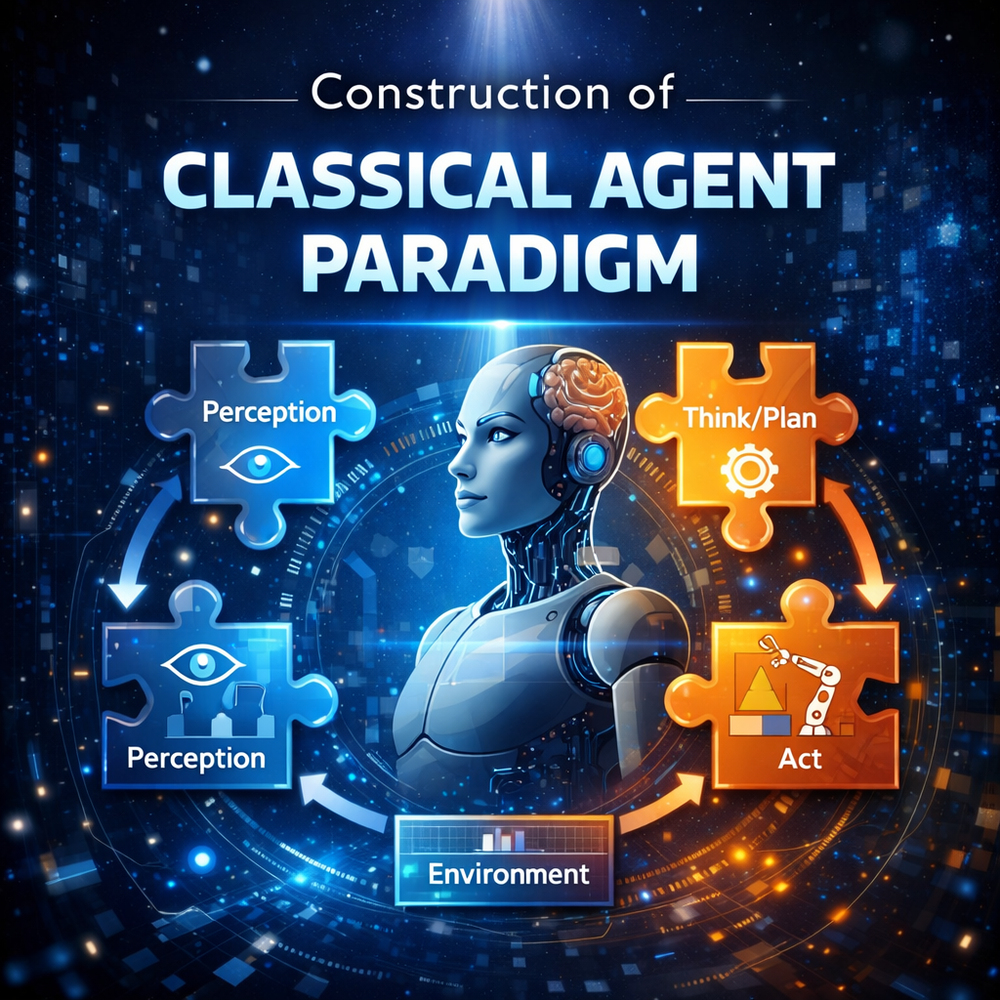

# 让 Agent 学会思考：推理范式

{width="350"}

::: {.callout-note}
## 上一章回顾

第 6 章我们为 Agent 装上了"手脚"——工具系统。Agent 现在能查询天气、推荐景点，但它只能机械地执行"思考→行动→观察"的单步循环。面对需要多步推理、动态调整策略的复杂任务时，这种简单循环力不从心。本章将引入三种经典的**推理范式**，让 Agent 学会更灵活地"思考"。
:::

现代 Agent 最具代表性的三种推理范式：

| 范式 | 核心思想 | 类比 |
|------|---------|------|
| **ReAct** | 推理与行动交替进行，边想边做，动态调整 | 侦探根据线索随时调整调查方向 |
| **Plan-and-Solve** | 先生成完整计划，再严格执行 | 建筑师先完成蓝图，再按图施工 |
| **Reflection** | 执行后自我评审，发现错误并修正 | 学生写完作业后自己检查一遍 |

## ReAct：边想边做

::: {.callout-tip}
## 配套代码

`code/chapter05_paradigms/` 包含三种范式的独立实现：
- `react_agent.py` — ReAct Agent
- `plan_and_solve.py` — Plan-and-Solve Agent
- `reflection_agent.py` — Reflection Agent

```bash
python code/chapter05_paradigms/react_agent.py
```
:::

ReAct（Reasoning + Acting）由 Shunyu Yao 于 2022 年提出，其核心思想是将**推理（Thought）**与**行动（Action）**显式结合，形成 "Thought → Action → Observation" 循环。

### 与简单工具调用的区别

第 6 章的旅行助手已经是 ReAct 的雏形。但现在我们让它更进一步：**ReAct Agent 会根据 Observation 动态调整后续推理**，而不是机械执行预设步骤。

### 完整实现

以下实现基于第 6 章的 ToolExecutor 扩展，增加了一个事实查询工具，并改进了 Action 解析逻辑：

```python
import re
import os
from openai import OpenAI
from dotenv import load_dotenv

load_dotenv()

# ============================================================
# 1. 工具定义
# ============================================================
def search_fact(query: str) -> str:
    """在本地知识库中查询事实"""
    fact_db = {
        "什么是智能体": "智能体（Agent）是一种能够感知环境、进行推理，并采取行动以达成目标的系统。",
        "智能体的核心组成": "智能体的核心组成包括：观察（Observation）、推理（Reasoning）、行动（Action）和记忆（Memory）。",
        "大语言模型和智能体的区别": "大语言模型主要负责生成文本，而智能体不仅能生成内容，还可以调用工具并执行行动。",
        "Transformer 的核心思想": "Transformer 的核心思想是使用注意力机制来建模序列，而不依赖循环结构。",
        "为什么智能体需要工具": "智能体需要工具来获取模型参数之外的信息或执行实际操作。",
    }

    # 简单相似度匹配
    def similarity(a: str, b: str) -> int:
        return len(set(a) & set(b))

    scores = [(k, similarity(query, k)) for k in fact_db]
    best = max(scores, key=lambda x: x[1])

    if best[1] >= 1:
        return f"FACT: {fact_db[best[0]]}"
    return "FACT: Not found"

# ============================================================
# 2. ToolExecutor（复用第6章的）
# ============================================================
class ToolExecutor:
    def __init__(self):
        self._tools = {}

    def register(self, name, description, func):
        self._tools[name] = {"description": description, "func": func}

    def get_func(self, name):
        t = self._tools.get(name)
        return t["func"] if t else None

    def get_descriptions(self):
        return "\n".join(
            f"- {name}: {info['description']}"
            for name, info in self._tools.items()
        )

    def execute(self, name, **kwargs):
        func = self.get_func(name)
        if func is None:
            return f"错误：未知工具 '{name}'"
        try:
            return func(**kwargs)
        except Exception as e:
            return f"工具执行错误: {e}"

# ============================================================
# 3. ReAct System Prompt
# ============================================================
REACT_PROMPT = """\
你是一个严格遵循 ReAct（Reason + Act）范式的智能体。

【核心原则】
1. 你只能通过 Action 行动
2. 任务完成的唯一方式是：Action: Finish[完整中文回答]

【可用工具】
{tool_descriptions}

【输出格式（每一步必须严格遵守）】
Thought: [分析当前状态、拆解任务、规划下一步]
Action: [具体行动，必须是以下格式之一]
- 工具调用（使用工具描述中的参数名）: tool_name(param_name="value")
- 任务完成: Finish[完整中文回答]

例如：
- search_fact(query="什么是智能体")
- Finish[智能体是...]

【FACT 收敛规则】
当 Observation 中出现 "FACT:" 开头的内容时，
这说明你已经获得了回答所需的全部关键信息。
你必须在下一步直接输出 Action: Finish[完整中文回答]。
"""

# ============================================================
# 4. 解析工具
# ============================================================
def extract_last_action(text: str) -> str | None:
    matches = re.findall(r"Action:\s*(.*)", text)
    return matches[-1].strip() if matches else None

def is_finish(action: str) -> bool:
    return action.startswith("Finish[")

def extract_finish(action: str) -> str | None:
    m = re.match(r"^Finish\[(.*)\]$", action, re.DOTALL)
    return m.group(1).strip() if m else None

def parse_tool_call(action: str) -> tuple[str | None, dict]:
    """解析工具调用：支持命名参数和位置参数"""
    # 清理前缀
    action = re.sub(r'^.*?[:：]\s*', '', action).strip()

    m = re.match(r"(\w+)\((.*)\)", action)
    if not m:
        return None, {}
    tool_name = m.group(1)
    args_str = m.group(2).strip()

    # 尝试命名参数: key="value"
    named = dict(re.findall(r'(\w+)\s*=\s*"([^"]*)"', args_str))
    if named:
        return tool_name, named

    # 尝试位置参数
    positional = re.findall(r'"([^"]*)"', args_str)
    if positional:
        return tool_name, {f"arg{i}": v for i, v in enumerate(positional)}

    return None, {}

def strip_think(text: str) -> str:
    """去除 DeepSeek-R1 等模型的 <think> 标签"""
    return re.sub(r"<think>[\s\S]*?</think>", "", text)

# ============================================================
# 5. LLM 客户端
# ============================================================
client = OpenAI(
    api_key=os.getenv("OPENAI_API_KEY", "ollama"),
    base_url=os.getenv("LLM_BASE_URL", "http://localhost:11434/v1"),
)
MODEL = os.getenv("LLM_MODEL_ID", "qwen3:14b")

def call_llm(system_prompt: str, history: str) -> str:
    resp = client.chat.completions.create(
        model=MODEL,
        messages=[
            {"role": "system", "content": system_prompt},
            {"role": "user", "content": history},
        ],
        temperature=0.3,
    )
    return strip_think(resp.choices[0].message.content)

# ============================================================
# 6. ReAct 主循环
# ============================================================
def run_react_agent(user_query: str, executor: ToolExecutor, max_steps: int = 5):
    system_prompt = REACT_PROMPT.format(
        tool_descriptions=executor.get_descriptions()
    )
    history = [f"用户请求: {user_query}"]

    print(f"用户输入: {user_query}")
    print("=" * 50)

    for step in range(1, max_steps + 1):
        print(f"\n--- Step {step} ---\n")
        prompt = "\n".join(history)
        llm_output = call_llm(system_prompt, prompt)
        print(f"模型输出:\n{llm_output}\n")
        history.append(llm_output)

        action = extract_last_action(llm_output)
        if action is None:
            history.append("Observation: 无法解析 Action")
            continue

        if is_finish(action):
            answer = extract_finish(action)
            if answer:
                print(f"✅ 任务完成:\n{answer}")
                return answer
            history.append("Observation: Finish 格式无效")
            continue

        tool_name, args = parse_tool_call(action)
        if tool_name is None:
            history.append(f"Observation: 无法解析工具调用: {action}")
            continue

        result = executor.execute(tool_name, **args)
        obs = f"Observation: {result}"
        print(f"{obs}\n" + "-" * 40)
        history.append(obs)

        # FACT 强制收敛
        if result.startswith("FACT:"):
            history.append("系统提示：已获得 FACT，请直接输出 Action: Finish[完整中文回答]。")

    print("⚠️ 达到最大步数")
    return None


# ============================================================
# 7. 运行
# ============================================================
executor = ToolExecutor()
executor.register("search_fact", "查询本地知识库中的事实信息", search_fact)

run_react_agent("什么是智能体？", executor)
```

### ReAct 的特点

| 优点 | 局限 |
|------|------|
| 高可解释性：Thought 链清晰展示决策依据 | 强依赖 LLM 能力：模型不稳定则流程失败 |
| 动态纠错：根据 Observation 实时调整 | 执行效率偏低：多轮 LLM 调用带来高延迟 |
| 工具协同：LLM 推理 + 外部工具执行 | 可能陷入局部最优：缺乏全局规划 |

## Plan-and-Solve：先规划，再执行

如果说 ReAct 像一名根据线索不断调整方向的侦探，那么 **Plan-and-Solve** 更像一位建筑师——在动工前先完成完整蓝图，然后严格按计划实施。

### 工作原理

Plan-and-Solve 将任务处理解耦为两个阶段：

1. **规划阶段（Planning）**：接收完整问题，拆解为清晰的分步计划。
2. **执行阶段（Solving）**：严格按计划逐步执行，每步结果作为下一步的输入。

```python
# ============================================================
# Plan-and-Solve 实现
# ============================================================

PLAN_PROMPT = """\
你是一个规划器。请为以下问题生成一个可执行的解决计划。

规划原则：
1. 每一步都是必要的，不允许冗余
2. 步骤必须是线性的、可顺序执行的
3. 每一步描述"要做什么"，而不是结论
4. 使用编号列表（1. 2. 3. ...）

问题：
{question}
"""

ACTION_PROMPT = """\
你是一个执行器。请严格执行给定计划中的当前步骤。

全局约束：
- 不允许新增、删除或重排步骤
- 不允许提前或总结后续步骤

完整计划：
{plan}

当前步骤：
{step}

原始问题：
{question}

请只完成当前步骤的内容。
"""


def plan_and_solve(question: str, verbose: bool = True):
    """Plan-and-Solve 主流程"""

    # ---- 规划阶段 ----
    plan_text = call_llm("You are a planning agent.",
                         PLAN_PROMPT.format(question=question))

    # 提取编号步骤
    steps = re.findall(r"^\s*\d+\.\s*(.+)", plan_text, re.MULTILINE)

    if verbose:
        print("===== PLAN =====")
        print(plan_text)

    # ---- 执行阶段 ----
    results = []
    for i, step in enumerate(steps, 1):
        if verbose:
            print(f"\n--- 执行步骤 {i}: {step} ---")

        result = call_llm(
            "You are an execution agent.",
            ACTION_PROMPT.format(
                plan=plan_text,
                step=step,
                question=question,
            ),
        )
        results.append({"step": step, "output": result.strip()})

        if verbose:
            print(result.strip())

    return {"question": question, "plan": plan_text, "steps": results}


# 运行测试
result = plan_and_solve(
    "一家公司想引入 AI 自动化客服流程，请分析是否适合自动化、主要风险和实施步骤。"
)
```

### Plan-and-Solve vs ReAct

| 维度 | ReAct | Plan-and-Solve |
|------|-------|---------------|
| 规划时机 | 边走边规划 | 执行前完成全部规划 |
| 灵活性 | 高，可动态调整 | 低，严格按计划执行 |
| 适用场景 | 信息不确定、需探索 | 结构清晰、目标明确 |
| 全局一致性 | 可能偏航 | 较好，计划约束全局方向 |

::: {.content-visible when-format="html"}
```{=html}
<div class="agent-toy" data-toy="ch07-paradigm-compare"></div>
```
:::

## Reflection：自我反思与改进

Reflection 机制源于人类的学习方式：完成初稿后校对，解题后验算。其流程概括为 **执行 → 反思 → 优化** 的三步循环：

```
Question
   ↓
[ Actor ]      → 初始回答
   ↓
[ Reflector ]  → 找问题 / 不足 / 风险
   ↓
[ Rewriter ]   → 基于反思改进
   ↓
Final Answer
```

```python
# ============================================================
# Reflection 实现
# ============================================================

ACTOR_PROMPT = "你是一个助手，请直接回答下面的问题。\n\n问题：\n{question}"

REFLECTION_PROMPT = """\
你是一个严格的审稿人。请对下面的回答进行反思和批评。

关注点（包括但不限于）：
- 是否遗漏重要方面
- 是否存在逻辑跳跃或模糊表述
- 是否有潜在风险或不严谨之处
- 是否可以更具体、更可执行

不要重写答案，只输出【问题清单】。

问题：{question}
回答：{answer}
"""

REWRITE_PROMPT = """\
你是一个改写助手。请基于下面的反思意见，对原始回答进行改进。

要求：
- 保留原有结构中合理的部分
- 明确修复反思中指出的问题
- 提供更清晰、可靠的最终回答

问题：{question}
原始回答：{answer}
反思意见：{reflection}
"""


def reflection_agent(question: str, verbose: bool = True):
    """Reflection Agent 主流程"""

    # 1. Actor：生成初始回答
    initial = call_llm(
        "You are an answering agent.",
        ACTOR_PROMPT.format(question=question),
    )
    if verbose:
        print("===== 初始回答 =====")
        print(initial, "\n")

    # 2. Reflector：找问题
    reflection = call_llm(
        "You are a reflection agent.",
        REFLECTION_PROMPT.format(question=question, answer=initial),
    )
    if verbose:
        print("===== 反思意见 =====")
        print(reflection, "\n")

    # 3. Rewriter：基于反思改进
    final = call_llm(
        "You are a rewriting agent.",
        REWRITE_PROMPT.format(
            question=question,
            answer=initial,
            reflection=reflection,
        ),
    )
    if verbose:
        print("===== 最终回答 =====")
        print(final, "\n")

    return {
        "question": question,
        "initial": initial,
        "reflection": reflection,
        "final": final,
    }


# 运行测试
result = reflection_agent(
    "一家公司想引入 AI 自动化客服流程，"
    "请分析是否适合自动化、主要风险和实施步骤。"
)
```

### Reflection 的成本与收益

| 成本 | 收益 |
|------|------|
| 每次迭代多出至少 2 次 LLM 调用 | 方案质量从"可用"提升到"高质量" |
| 任务延迟增加（串行执行） | 通过内部纠错减少逻辑漏洞和事实错误 |
| 需设计多套 Prompt（Actor / Critic / Rewriter） | 适用于对准确性和可靠性要求高的场景 |

::: {.content-visible when-format="html"}
```{=html}
<div class="agent-toy" data-toy="ch07-reflection-loop"></div>
```
:::

::: {.callout-tip}
Reflection 本质上是**以计算成本换输出质量**的策略，适合代码生成、技术方案评审与高准确度报告；实时交互场景通常优先选择 ReAct 或 Plan-and-Solve。
:::

## 三种范式对比总结

| 维度 | ReAct | Plan-and-Solve | Reflection |
|------|-------|---------------|------------|
| 核心机制 | 思考与行动交替 | 先规划再执行 | 执行后反思改进 |
| LLM 调用次数 | 多（每步一次） | 中（规划1次+每步1次） | 至少3次 |
| 灵活性 | 高 | 低 | 中 |
| 输出质量 | 中 | 中高 | 高 |
| 适用场景 | 探索性任务 | 结构化任务 | 质量敏感任务 |
| 实现难度 | 中 | 中 | 中 |

::: {.callout-note}
## 下一章预告

至此，我们已经掌握了构建单个 Agent 的所有核心要素：LLM 调用（第3章）、工具系统（第6章）和推理范式（本章）。但每次构建新 Agent 都要从零手写这些组件，效率很低。第 8 章我们将把这些能力抽象为**可复用的框架组件**——自建一个轻量 Agent 框架。
:::

## 练习

1. 修改 ReAct Agent，使其支持 `get_weather` 和 `get_attraction` 工具（复用第6章的旅行助手工具），测试它是否能自主完成"规划一次北京之旅"的任务。
2. 在 Plan-and-Solve 中引入工具调用能力：让 Planner 规划的工具调用步骤也能被 Executor 执行（提示：需要整合 ToolExecutor）。
3. 为 Reflection Agent 增加第二轮反思：用改进后的回答再次进行反思和改写，观察质量是否有进一步提升。
