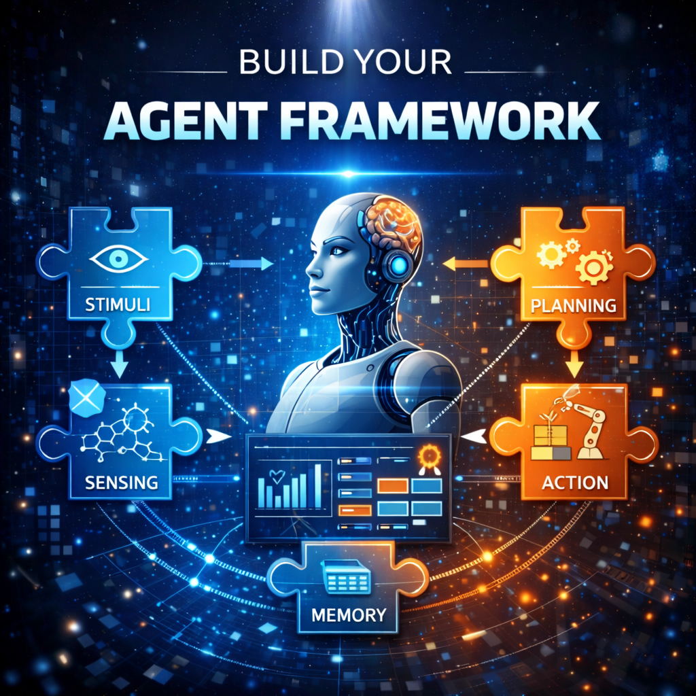

# 自建轻量 Agent 框架

{width="350"}

::: {.callout-note}
## 上一章回顾

第 7 章我们掌握了三种推理范式：ReAct、Plan-and-Solve 和 Reflection。前七章我们积累了构建 Agent 的全部要素：LLM 调用、工具系统和推理范式。但每次构建新 Agent 都要从零手写 `call_llm()`、`ToolExecutor`、`parse_tool_call()` 等组件。本章将这些可复用的能力抽象为框架组件，让你从"脚本作者"升级为"框架构建者"。
:::

## 为什么要自建框架

智能体领域框架迭代极快。对学习者而言，最常见的问题不是"找不到框架"，而是"框架太多、概念太多、接口变化太快"。自建框架的目标不是重复造轮子，而是**掌握轮子的结构和制造方法**。

自建框架带来的三种核心能力：

1. **真正理解运行机制**：每行代码都是你写的，没有黑盒
2. **对关键路径拥有控制权**：需要定制时不必在框架依赖中打补丁
3. **训练系统设计能力**：把 Agent 从"玩具"变成"工程"

## 框架核心组件

::: {.callout-tip}
## 配套代码

完整框架位于 `code/chapter06_framework/hello_agents/`，安装方式：

```bash
cd code/chapter06_framework
pip install -e .
```

然后在 Python 中使用：

```python
from hello_agents import HelloAgentsLLM, SimpleAgent, Config
```
:::

一个轻量 Agent 框架至少需要四个核心模块：

| 模块 | 职责 | 对应前几章的痛点 |
|------|------|-----------------|
| **HelloAgentsLLM** | 统一 LLM 调用接口 | 每章都在重复写 `OpenAI()` 客户端 |
| **Message** | 标准化消息表示 | 散落的 dict 格式不统一 |
| **Config** | 集中管理配置 | 温度、最大 token 等参数散落各处 |
| **Agent 基类** | 统一执行入口 + 历史管理 | 每章重复实现 `history` 逻辑 |

### 1. LLM 调用中枢

```python
# hello_agents/core/llm.py
import os
from typing import Sequence
from openai import OpenAI


class HelloAgentsLLM:
    """统一 LLM 调用接口（OpenAI 兼容）"""

    def __init__(
        self,
        model: str | None = None,
        api_key: str | None = None,
        base_url: str | None = None,
        temperature: float = 0.7,
    ):
        self.model = model or os.getenv("LLM_MODEL_ID", "qwen3:14b")
        self.temperature = temperature

        self._client = OpenAI(
            api_key=api_key or os.getenv("OPENAI_API_KEY", "ollama"),
            base_url=base_url or os.getenv("LLM_BASE_URL", "http://localhost:11434/v1"),
        )

    def invoke(self, messages: list[dict], **kwargs) -> str:
        """非流式调用"""
        t = kwargs.pop("temperature", self.temperature)
        resp = self._client.chat.completions.create(
            model=self.model,
            messages=messages,
            temperature=t,
            **kwargs,
        )
        return (resp.choices[0].message.content or "").strip()

    def think(self, messages: list[dict], **kwargs) -> str:
        """流式调用（生成器）"""
        t = kwargs.pop("temperature", self.temperature)
        stream = self._client.chat.completions.create(
            model=self.model,
            messages=messages,
            temperature=t,
            stream=True,
            **kwargs,
        )
        for event in stream:
            delta = event.choices[0].delta
            if delta.content:
                yield delta.content
```

### 2. 消息系统

```python
# hello_agents/core/message.py
from __future__ import annotations
from dataclasses import dataclass, field
from datetime import datetime, timezone
from typing import Literal


MessageRole = Literal["user", "assistant", "system", "tool"]


@dataclass
class Message:
    """框架内部的标准消息对象"""
    content: str
    role: MessageRole
    timestamp: datetime = field(default_factory=lambda: datetime.now(timezone.utc))

    def to_dict(self) -> dict:
        return {"role": self.role, "content": self.content}

    def compact(self, max_len: int = 120) -> str:
        text = self.content.replace("\n", " ").strip()
        if len(text) > max_len:
            text = text[:max_len - 3] + "..."
        return f"[{self.role}] {text}"
```

### 3. 配置系统

```python
# hello_agents/core/config.py
from dataclasses import dataclass, field
from typing import Any


@dataclass
class Config:
    """框架统一配置"""
    # LLM 相关
    temperature: float = 0.7
    max_tokens: int | None = None

    # 历史管理
    max_history_length: int = 100
    truncate_strategy: str = "drop_oldest"

    # 调试
    debug: bool = False

    # 扩展
    extra: dict[str, Any] = field(default_factory=dict)

    def with_updates(self, **kwargs) -> "Config":
        """返回带有更新字段的新 Config（不可变风格）"""
        data = {k: v for k, v in self.__dict__.items()}
        for k, v in kwargs.items():
            if k in data:
                data[k] = v
            else:
                data.setdefault("extra", {})[k] = v
        return Config(**data)
```

### 4. Agent 基类

这是框架最核心的抽象——统一所有 Agent 范式的入口和行为：

```python
# hello_agents/core/agent.py
from abc import ABC, abstractmethod
from .message import Message
from .config import Config
from .llm import HelloAgentsLLM


class Agent(ABC):
    """Agent 抽象基类"""

    def __init__(
        self,
        name: str,
        llm: HelloAgentsLLM,
        system_prompt: str | None = None,
        config: Config | None = None,
    ):
        self.name = name
        self.llm = llm
        self.system_prompt = system_prompt
        self.config = config or Config()
        self._history: list[Message] = []

    # ===== 公开 API =====

    def run(self, input_text: str, **kwargs) -> str:
        """稳定入口：组装消息 → 调用执行 → 写入历史 → 截断历史"""
        messages = self._build_messages(input_text)

        if self.config.debug:
            print(f"[DEBUG] {self.name} messages:")
            for m in messages:
                print(f"  {m.compact()}")

        output = self._execute(messages, **kwargs)

        self.add_message(Message(role="user", content=input_text))
        self.add_message(Message(role="assistant", content=output))
        self._truncate_history()

        return output

    def add_message(self, message: Message) -> None:
        self._history.append(message)

    def get_history(self) -> list[Message]:
        return list(self._history)

    # ===== 子类实现 =====

    @abstractmethod
    def _execute(self, messages: list[Message], **kwargs) -> str:
        """子类实现核心逻辑"""
        ...

    # ===== 内部方法 =====

    def _build_messages(self, input_text: str) -> list[Message]:
        """组装 system + history + current user"""
        msgs = []
        if self.system_prompt:
            msgs.append(Message(role="system", content=self.system_prompt))
        msgs.extend(self._history)
        msgs.append(Message(role="user", content=input_text))
        return msgs

    def _truncate_history(self) -> None:
        limit = self.config.max_history_length
        if limit and len(self._history) > limit:
            self._history = self._history[-limit:]
```

### 5. SimpleAgent：最简实现

```python
# hello_agents/agents/simple_agent.py
from hello_agents.core.agent import Agent
from hello_agents.core.message import Message
from hello_agents.core.llm import HelloAgentsLLM
from hello_agents.core.config import Config


class SimpleAgent(Agent):
    """最简 Agent：直接把 messages 交给 LLM"""

    def _execute(self, messages: list[Message], **kwargs) -> str:
        return self.llm.invoke([m.to_dict() for m in messages], **kwargs)


# --- 使用示例 ---
if __name__ == "__main__":
    from dotenv import load_dotenv
    load_dotenv()

    cfg = Config(debug=True, max_history_length=10)
    llm = HelloAgentsLLM()

    agent = SimpleAgent(
        name="助手",
        llm=llm,
        system_prompt="你是一个简洁的技术助教。",
        config=cfg,
    )

    print(agent.run("我叫Liam"))
    print(agent.run("我叫什么？"))
    print(f"历史消息数: {len(agent.get_history())}")
```

## 框架带来的简化

对比第 6 章手写的旅行助手和第 7 章的 ReAct Agent，框架抽象后的代码量显著减少：

| 能力 | 手写实现（ch6-7） | 框架实现（ch8） |
|------|------------------|----------------|
| 历史管理 | 每章手写 `history.append()` | Agent 基类自动管理 |
| LLM 调用 | 每处 `client.chat.completions.create()` | `llm.invoke(messages)` |
| 配置管理 | 散落在各处 `temperature=0.3` | Config 单点管理 |
| 调试输出 | 手写 `print()` | Config.debug 开关控制 |

更重要的是，**新增 Agent 范式只需继承 `Agent` 基类并实现 `_execute()` 方法**，所有配置、消息标准化与历史管理都能直接复用。

::: {.content-visible when-format="html"}
```{=html}
<div class="agent-toy" data-toy="ch08-framework-blocks"></div>
```
:::

::: {.callout-tip}
## 设计取舍

HelloAgents 刻意做了三个简化，这在教学阶段非常重要：

1. **工具系统暂未内置进 Agent 基类**——因为并非所有范式都需要工具（如 Plan-and-Solve 可以是纯推理），工具应作为可选能力按需注入。
2. **Config 采用不可变设计**（`with_updates()` 返回新对象）——避免运行时意外修改导致行为不可预测。
3. **Message 使用 dataclass 而非 dict**——提供类型安全和 IDE 补全，同时保留 `to_dict()` 作为对外兼容层。
:::

::: {.content-visible when-format="html"}
```{=html}
<div class="agent-toy" data-toy="ch08-lifecycle-hooks"></div>
```
:::

## 本章小结

本章我们将前七章的实践提炼为轻量框架 HelloAgents：

- **HelloAgentsLLM** 统一模型调用，屏蔽不同服务商的差异
- **Message** 标准化消息表示，支撑整个上下文工程
- **Config** 集中管理配置，使行为可预测、可重现
- **Agent 基类** 定义了统一的 Agent 生命周期：`run() → _build_messages() → _execute() → 历史管理`

从下一章开始，我们将在 HelloAgents 基础上逐步扩展：记忆系统、上下文工程、多智能体协作——每一章都是对框架的一次能力升级。

::: {.callout-note}
## 下一章预告

有了稳定的框架底座，我们开始应对 Agent 的核心局限：对话遗忘。第 9 章将为 Agent 装上"记忆"——实现工作记忆、情景记忆和语义记忆。第 10 章将通过 RAG 检索增强突破模型的知识截止局限。
:::

## 练习

1. 基于 Agent 基类，实现第 7 章的 ReAct Agent：继承 Agent，在 `_execute()` 中实现 Thought-Action-Observation 循环。
2. 为 Config 增加 `max_steps` 字段，用于控制 Agent 循环的最大步数。在 ReAct Agent 中使用这个配置。
3. 尝试将第 6 章的 ToolExecutor 集成到框架中，使 Agent 基类支持可选的工具注册。
