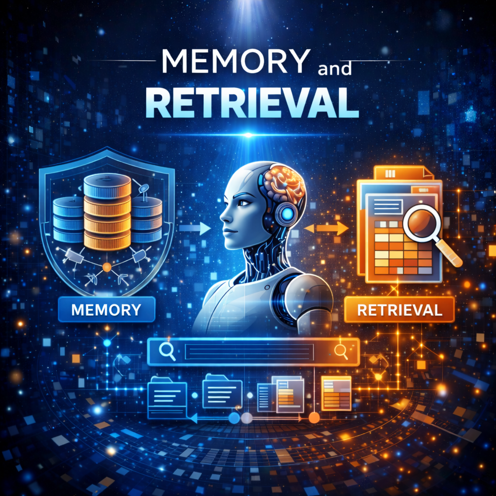

# 记忆系统

{width="350"}

::: {.callout-note}
## 上一章回顾

第 8 章我们将前几章的能力抽象为 HelloAgents 框架。但这框架的 Agent 有一个明显缺陷：记忆仅限于当前对话的 `_history` 列表。一旦对话结束或超出长度限制，所有交互信息永久丢失。本章将为 Agent 装上真正的"记忆系统"。
:::

## 为什么 Agent 需要记忆

### 两个根本局限

当前基于 LLM 的 Agent 面临两个核心问题：

**局限一：对话遗忘**

LLM 本身是无状态的——每次 API 调用都是独立的。我们虽然通过 `history` 列表实现了对话内记忆，但这只在单次会话内有效。关闭程序、重置 `history`，一切都忘了。

```
对话 1: "我叫小明，我在学 Python。"
对话 2: "还记得我吗？" → "抱歉，我不知道你是谁。"  ❌
```

**局限二：知识静态性**

模型的知识截止于训练数据。它不知道今天发生了什么，无法积累新的经验。

### 从人类记忆得到启发

认知心理学将人类记忆分为多个层次：

```
感觉记忆 (0.5-3秒) → 工作记忆 (15-30秒, 7±2项) → 长期记忆 (永久的, 几乎无限)
                                                      ├── 程序性记忆（技能）
                                                      └── 陈述性记忆（知识）
                                                           ├── 语义记忆（"巴黎是法国首都"）
                                                           └── 情景记忆（"昨天的会议"）
```

我们为 Agent 设计类似的多层记忆系统。

::: {.callout-tip}
## 配套代码

```bash
python chapter09_memory/working_memory.py     # 工作记忆
python chapter09_memory/episodic_memory.py    # 情景记忆
python chapter09_memory/semantic_memory.py    # 语义记忆
python chapter09_memory/memory_manager.py     # 记忆管理器
python chapter09_memory/forgetting.py         # 遗忘策略
python chapter09_memory/memory_agent.py       # 完整项目
```
:::

## 工作记忆

工作记忆就像计算机的 **RAM**——容量有限，存储当前会话的临时信息，自动过期。

### 核心特征

| 特征 | 实现 |
|------|------|
| 容量限制 | 默认 50 条，超出时驱逐最不重要/最旧的 |
| TTL 过期 | 默认 30 分钟自动清理 |
| 快速检索 | 关键词匹配 + 时间衰减 |

### 实现

```python
class WorkingMemory:
    def __init__(self, max_capacity=50, ttl_seconds=1800):
        self.max_capacity = max_capacity
        self.ttl_seconds = ttl_seconds
        self._items = []

    def add(self, content: str, importance: float = 0.5):
        self._cleanup()
        self._items.append({
            "content": content,
            "importance": importance,
            "timestamp": time.time(),
        })
        # 溢出时驱逐最不重要的
        if len(self._items) > self.max_capacity:
            self._items.sort(key=lambda x: x["importance"])
            self._items = self._items[-(self.max_capacity):]

    def search(self, query: str, limit=10):
        self._cleanup()
        scored = []
        for item in self._items:
            score = self._relevance(query, item["content"])
            score *= self._time_decay(item)
            score *= (0.5 + item["importance"] * 0.5)
            scored.append((item, score))
        scored.sort(key=lambda x: x[1], reverse=True)
        return [item for item, _ in scored[:limit]]
```

检索评分：`关键词匹配度 × 时间衰减 × 重要性加权`

## 情景记忆

情景记忆存储**具体的事件和经历**——带时间戳、会话 ID、事件类型。

```python
class EpisodicMemory:
    def add(self, content, importance=0.5, session_id=None,
            event_type="general", **metadata):
        self._episodes.append({
            "content": content,
            "importance": importance,
            "timestamp": time.time(),
            "session_id": session_id,
            "event_type": event_type,
        })

    def search(self, query, session_id=None, event_type=None):
        # 支持按会话、事件类型筛选
        # 评分 = 关键词 × 时间近因性 × 重要性
        ...

    def get_by_session(self, session_id: str):
        """按会话ID恢复完整对话记录"""
        ...
```

## 语义记忆

语义记忆存储**抽象知识和概念关系**，自动提取三元组 `(subject, relation, value)`：

```python
class SemanticMemory:
    def _extract_triples(self, text):
        """简单三元组提取"""
        # "A 是 B" → ("A", "is_a", "B")
        # "A 能 B" → ("A", "can", "B")
        ...

    def get_entities(self) -> list[str]:
        """获取知识图谱中所有实体"""

    def get_relations(self, entity: str):
        """查询与某实体相关的所有事实"""
```

## 记忆管理器：统一调度

```python
class MemoryManager:
    def __init__(self):
        self.working = WorkingMemory(max_capacity=50)
        self.episodic = EpisodicMemory(max_capacity=200)
        self.semantic = SemanticMemory(max_facts=200)

    def add(self, content, memory_type, importance=0.5):
        """统一添加接口，自动路由到合适的记忆系统"""

    def search(self, query, memory_types=None, limit=10):
        """跨类型统一搜索，按重要性排序合并结果"""

    def consolidate(self, from_type, to_type, importance_threshold=0.7):
        """记忆整合：工作记忆→情景记忆→语义记忆"""

    def forget(self, strategy, threshold, max_age_days):
        """遗忘：基于重要性/时间/容量"""
```

::: {.content-visible when-format="html"}
```{=html}
<div class="agent-toy" data-toy="ch09-memory-triad"></div>
```
:::

## 三种遗忘策略

| 策略 | 逻辑 | 适用场景 |
|------|------|---------|
| **基于重要性** | 删除 `importance < 阈值` 的记忆 | 通用清理 |
| **基于时间** | 删除 `timestamp > N天前` 的记忆 | 隐私合规 |
| **基于容量** | 只保留最重要的 N% | 资源受限 |

::: {.content-visible when-format="html"}
```{=html}
<div class="agent-toy" data-toy="ch09-ebbinghaus-decay"></div>
```
:::

## 项目：带记忆的 Agent

```python
class MemoryAgent:
    def run(self, user_input: str) -> str:
        # 1. 检索相关记忆
        memories = self.memory.search(query=user_input, limit=5)

        # 2. 构建增强 Prompt（注入记忆上下文）
        memory_context = self._format_memories(memories)
        messages = [system_prompt, memory_context] + history + [user_input]

        # 3. 调用 LLM
        reply = self.llm.invoke(messages)

        # 4. 自动从对话中提取并存储关键信息
        self._auto_remember(user_input, reply)
        return reply
```

完整代码见 `code/chapter09_memory/memory_agent.py`。

## 本章小结

| 记忆类型 | 定位 | 容量 | 生命周期 |
|---------|------|------|---------|
| **工作记忆** | 当前会话临时信息 | ~50 条 | TTL 过期 |
| **情景记忆** | 具体事件和经历 | ~200 条 | 永久（手动遗忘） |
| **语义记忆** | 抽象知识和概念 | ~200 条 | 永久（手动遗忘） |

关键能力：统一调度、跨类型搜索、记忆整合、三种遗忘策略。

::: {.callout-note}
## 下一章预告

有了记忆系统，Agent 能记住更多信息。但上下文窗口有限——如何从海量外部文档中**检索**最相关的知识？下一章将介绍 **RAG（检索增强生成）**——让 Agent 突破知识截止的限制。
:::

## 练习

1. 扩展工作记忆的容量为 100，观察多轮对话中记忆质量的变化。
2. 为情景记忆添加"情感标记"（正面/负面/中性），在检索时根据情感筛选。
3. 实现记忆整合的自动化：每隔 N 轮对话，自动将高重要性工作记忆提升为情景记忆。
