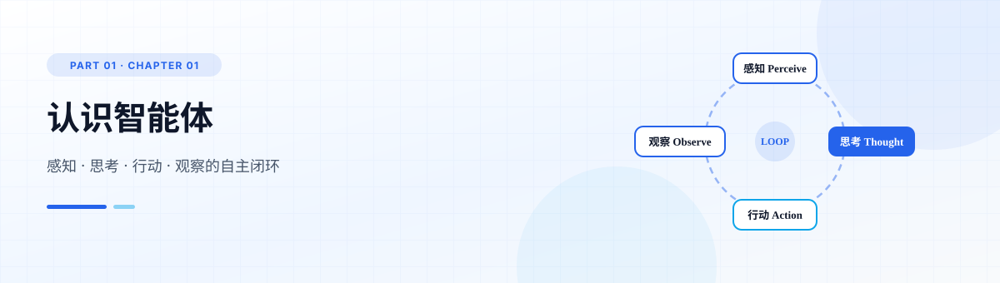

# 认识智能体

{.chapter-hero width="100%"}
## 什么是智能体

在人工智能领域，**智能体（Agent）** 是指能够通过传感器感知环境，并自主地借助执行器采取行动，以实现特定目标的实体。

这一概念包含四个核心要素：**环境、传感器、执行器和目标**。环境是智能体所处的外部世界——自动驾驶汽车面对的是不断变化的道路交通，交易算法面对的是高速波动的金融市场。智能体通过传感器持续获取环境信息：摄像头、雷达、麦克风或 API 返回的数据，都是其感知能力的体现。在获得信息后，智能体需通过执行器对环境施加影响——执行器既可以是物理装置（如机械臂），也可以是虚拟手段（如执行代码或调用服务）。

真正使智能体具备"智能"的关键在于其**自主性**：它并非简单地被动响应刺激，而是能够基于感知结果和内部状态进行独立决策，以实现既定目标。由此形成的 **"感知—决策—行动"** 闭环，构成了智能体行为的基本机制。

### 传统视角下的智能体

在大语言模型兴起之前，人工智能领域已对"智能体"展开了数十年的研究。传统智能体沿着一条由简入繁、由被动反应走向主动学习的演进路径发展而来。

这一演进的起点是结构最简单的**反射智能体**，其决策机制基于工程师预先设定的"条件—动作"规则，例如自动恒温器。这类智能体完全依赖当前感知，不具备记忆或预测能力。随后，为应对更复杂的场景，传统智能体逐步演进：

- **基于模型的反射智能体**：用内部世界模型与记忆理解当前状态
- **基于目标的智能体**：通过规划选择通向目标的行动
- **基于效用的智能体**：在多目标间权衡、最大化期望效用
- **学习型智能体**：通过强化学习从经验中不断优化策略

### 大语言模型驱动的新范式

以 GPT 为代表的大语言模型正在深刻改变智能体的构建方式。由大语言模型驱动的 **LLM 智能体**，在核心决策机制上与传统智能体存在本质差异：

| 维度     | 传统智能体         | LLM 智能体         |
|----------|--------------------|--------------------|
| 核心引擎 | 人工编码的规则     | 预训练大语言模型   |
| 知识来源 | 工程师显式编写     | 海量数据隐式学习   |
| 交互方式 | 结构化输入输出     | 自然语言理解与生成 |
| 适应能力 | 固定规则，难以泛化 | 涌现能力，灵活通用 |

LLM 智能体能够直接理解高层次、富含上下文的自然语言目标，并自主完成任务规划、工具调用与动态修正。

::: {.content-visible when-format="html"}
```{=html}
<div class="agent-toy" data-toy="ch01-chatbot-vs-agent"></div>
```
:::

::: {.callout-tip}
## 本书的学习路径

全书采用“逐章叠加”的演进式结构，每章只引入一项核心工程能力：

**第一部分：基础对话 Agent（第 1–4 章）**

1. 认识智能体，构建 30 行最简对话 Agent（第 1 章）
2. 掌握 LLM API 调用、参数控制、Token 机制与成本核算（第 2 章）
3. 实现多轮对话、System Prompt 工程、历史截断与状态追踪（第 3 章）
4. 落地流式输出、错误分类、指数退避重试与降级策略（第 4 章）

**第二部分：Agent 能力扩展（第 5–8 章）**

5. 实现结构化输出、Pydantic 校验与原生 Function Calling（第 5 章）
6. 构建可扩展且安全的工具系统（第 6 章）
7. 掌握 ReAct、Plan-and-Solve、Reflection 三大推理范式（第 7 章）
8. 自建轻量 Agent 框架，理解底层抽象与生命周期设计（第 8 章）

**第三部分：进阶能力（第 9–13 章）**

9. 设计三层记忆架构与基于遗忘曲线的淘汰机制（第 9 章）
10. 从零实现 RAG 检索增强生成流水线（第 10 章）
11. 深入上下文工程：组装、压缩、Token 预算与前缀缓存（第 11 章）
12. 构建多智能体协作拓扑与结构化交接协议（第 12 章）
13. 建立评估与基准测试体系（第 13 章）
:::

## 智能体的构成：PEAS 模型

要理解智能体的运作，首先需要理解它所处的任务环境。在人工智能领域，通常使用 **PEAS 模型** 来精确描述一个任务环境：

- **P（Performance，性能度量）**：如何衡量智能体做得好不好？例如，自动驾驶的度量包括安全性、舒适性、到达时间。
- **E（Environment，环境）**：智能体所处的外部世界是什么？例如，自动驾驶的环境是道路、交通信号、其他车辆和行人。
- **A（Actuators，执行器）**：智能体通过什么来影响环境？例如，方向盘、油门、刹车、转向灯。
- **S（Sensors，传感器）**：智能体通过什么来感知环境？例如，摄像头、雷达、GPS、速度计。

以我们将在第 6 章构建的**旅行助手 Agent** 为例，其 PEAS 描述如下：

| 要素          | 旅行助手 Agent                                   |
|---------------|--------------------------------------------------|
| P（性能度量） | 提供准确、有用的旅行建议                         |
| E（环境）     | 天气 API、景点数据库、用户输入的偏好             |
| A（执行器）   | 调用天气查询函数、调用景点推荐函数、输出建议文本 |
| S（传感器）   | 用户输入的文本指令                               |

## 智能体的运行机制：Agent 循环

智能体并非一次性完成任务，而是通过一个持续的循环与环境交互，这个核心机制被称为 **Agent Loop**：

```         
┌──────────────────────────────────────────────────────┐
│                   Agent Loop                          │
│                                                       │
│  感知 (Perception)  ──→  思考 (Thought)  ──→  行动 (Action)  │
│       ↑                                          │       │
│       └──────── 观察 (Observation) ←─────────────┘       │
└──────────────────────────────────────────────────────┘
```

1.  **感知（Perception）**：智能体通过传感器（API 监听端口、用户输入接口）接收来自环境的输入信息，即**观察（Observation）**。

2.  **思考（Thought）**：智能体进入核心决策阶段。对于 LLM 智能体而言，这通常由大语言模型驱动，可细分为两个关键环节：

    - **规划（Planning）**：基于当前观察和内部记忆，制定或调整行动计划。
    - **工具选择（Tool Selection）**：从可用工具库中选择最合适的工具并确定调用参数。

3.  **行动（Action）**：智能体通过执行器执行具体行动——通常表现为调用一个选定工具（如代码解释器、搜索引擎 API）。

4.  **观察（Observation）**：行动引起环境状态变化，环境产生新的观察作为反馈，触发下一轮循环。

通过反复执行这一闭环，智能体得以将高层次的用户意图拆解为可验证的执行步骤，并在环境反馈中持续修正方向。

::: {.content-visible when-format="html"}
```{=html}
<div class="agent-toy" data-toy="ch01-loop-stepper"></div>
```
:::

## 动手实践：你的第一个 Agent

::: {.callout-tip}
## 配套代码

本章完整代码位于 `code/chapter01_simple_agent/simple_agent.py`，可独立运行：

```bash
cd code
pip install -r requirements.txt
cp .env.example .env  # 编辑 .env 填入你的 API Key
python chapter01_simple_agent/simple_agent.py
```
:::

下面用约 30 行 Python 代码构建一个**最简对话 Agent**：它支持多轮对话并维护上下文历史。

### 环境准备

确保已安装 `openai` 库，并配置好 API 密钥（支持 OpenAI、Ollama 等任何兼容 OpenAI 接口的服务）：

```bash
pip install openai python-dotenv
```

在项目根目录创建 `.env` 文件：

```bash
# 使用 OpenAI
OPENAI_API_KEY=sk-your-key-here

# 或使用本地 Ollama
# LLM_BASE_URL=http://localhost:11434/v1
# LLM_MODEL_ID=llama3.2
# LLM_API_KEY=ollama
```

### 最简对话 Agent

```python
import os
from openai import OpenAI
from dotenv import load_dotenv

load_dotenv()

class SimpleAgent:
    """最简 Agent：能对话、能记住历史"""

    def __init__(self, name: str, system_prompt: str = "你是一个有用的AI助手。"):
        self.name = name
        self.system_prompt = system_prompt
        self.history = []  # 对话历史

        # 初始化 LLM 客户端
        self.client = OpenAI(
            api_key=os.getenv("OPENAI_API_KEY", "ollama"),
            base_url=os.getenv("LLM_BASE_URL", "http://localhost:11434/v1"),
        )
        self.model = os.getenv("LLM_MODEL_ID", "qwen3:14b")

    def run(self, user_input: str) -> str:
        # 1. 将用户输入加入历史
        self.history.append({"role": "user", "content": user_input})

        # 2. 构建完整消息
        messages = [{"role": "system", "content": self.system_prompt}] + self.history

        # 3. 调用 LLM
        response = self.client.chat.completions.create(
            model=self.model,
            messages=messages,
        )

        # 4. 提取回复并加入历史
        reply = response.choices[0].message.content
        self.history.append({"role": "assistant", "content": reply})

        return reply

    def get_history(self):
        return self.history


# --- 测试 ---
agent = SimpleAgent(name="小助手")

print("=" * 50)
print("Agent:", agent.run("你好，我叫小明。"))
print()
print("Agent:", agent.run("还记得我叫什么吗？"))
print("=" * 50)
print(f"对话历史共 {len(agent.get_history())} 条消息")
```

运行结果：

```         
==================================================
Agent: 你好小明！很高兴认识你。有什么我可以帮助你的吗？

Agent: 当然记得！你刚才告诉我你叫小明。
==================================================
对话历史共 4 条消息
```

### 代码拆解

虽然只有 30 行代码，但它已经包含了 Agent 的核心要素：

| 要素     | 代码中的体现                       | 对应概念              |
|----------|------------------------------------|-----------------------|
| 感知     | `user_input` 参数                  | Agent 接收环境输入    |
| 思考     | `client.chat.completions.create()` | LLM 进行推理          |
| 行动     | `return reply`                     | Agent 输出回复        |
| 记忆     | `self.history` 列表                | 保存对话上下文        |
| 系统提示 | `system_prompt`                    | 定义 Agent 的行为边界 |

这个最简 Agent 虽然能对话，但它只能"说"，不能"做"。在接下来的章节中，我们将逐步为它添加**工具调用**、**推理能力**、**长期记忆**和**多 Agent 协作**等能力，让它成为一个真正能自主完成任务的智能体。

## 本章小结

本章我们建立了对智能体的基本认知：

- 智能体 = 感知 + 决策 + 行动，是一个与环境持续交互的自主系统
- PEAS 模型是描述智能体任务环境的标准框架
- Agent Loop 是智能体运行的核心机制
- LLM 智能体通过海量预训练获得了传统规则系统无法企及的灵活性与通用性
- 仅需 30 行 Python 即可构建一个能对话、有记忆的最简 Agent

::: {.callout-note}
## 下一章预告

第 2 章将进入动手环节——配置开发环境、获取 API Key、发送第一个 API 请求、理解 Token 概念。你将亲手构建一个能与大模型对话的交互式聊天机器人。这是构建 Agent 的第一步。
:::
